# Actions

An action is the work that OpenCraft does when you operate a control. This
chapter gives each action kind and its settings. The procedure to set an
action is in [Configure a key](first-key.md#4-set-an-action).

The action kinds are in four groups. The [library](#the-library) and the
menu of the action kinds show the groups and the kinds in this order:

| Group | Action kind | Needs the Accessibility permission |
|---|---|---|
| System | [Open an application](#open-an-application) | No |
| System | [Quit an application](#quit-an-application) | No |
| System | [Open a URL](#open-a-url) | No |
| System | [Run a shell command](#run-a-shell-command) | No |
| System | [Send a hotkey](#send-a-hotkey) | Yes |
| System | [Mouse event](#mouse-event) | Yes |
| System | [Mac system function](#mac-system-function) | Yes |
| System | [Type text](#type-text) | Yes |
| Media | [Media key](#media-key) | Yes |
| Media | [Sound volume](#sound-volume) | No |
| Device | [Screen off and Device sleep](#screen-off-and-device-sleep) | No |
| Device | [Device brightness](#device-brightness) | No |
| Navigation | [Change the page](#change-the-page) | No |
| Navigation | [Select a profile](#select-a-profile) | No |
| Logic | [Toggle](#toggle) | Only for the actions that it contains |
| Logic | [Sequence of actions](#sequence-of-actions) | Only for the actions that it contains |

The permission is in
[Install and first start](install.md#give-the-accessibility-permission).

## The library

The tab **Library** of the right panel shows all action kinds in their
groups. Each row shows the tile of the kind, its name, and at the right a
short help text: "Accessibility" for a kind that needs the Accessibility
permission, and "Knob" for **Sound volume**, which is best on a knob. The
tile has the colour of the group and the icon of the kind, for example a
globe for **Open a URL**.

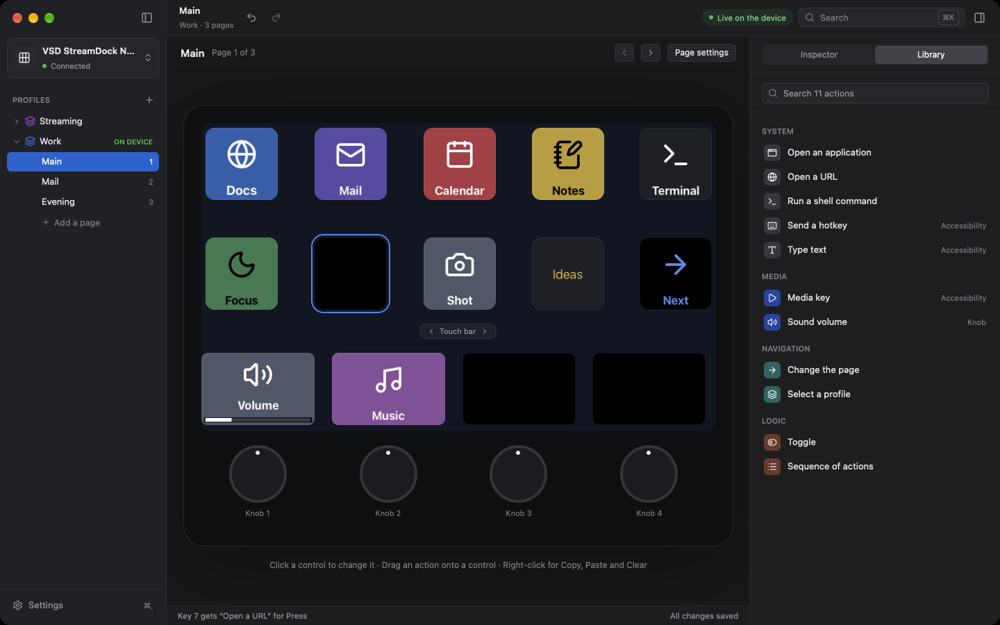

To set an action with the library:

1. In the device picture, click a key face, a bar panel, or a knob.
2. Click **Library** at the top of the right panel.
3. Click an action kind.

The action goes on the open card of the control, with the default settings
of the kind. If no card is open, the action goes on the first gesture:
**Press** for a key, **Tap** for a bar panel, and **Turn** for a knob (the
action goes on the two turn directions).
If the gesture has an action already, the new action replaces it. To get the
old action back, push Command-Z. The status bar shows the change for 4
seconds, for example "Key 7 gets “Open a URL” for Press". The right panel
stays on **Library**. Click **Inspector** to change the settings of the new
action.

If the page or the device is selected, a click on an action kind does
nothing, and the status bar shows "Select a control first".

### Drag an action onto a control

You can also drag an action kind from the library onto a control. You do
not have to select the control first.

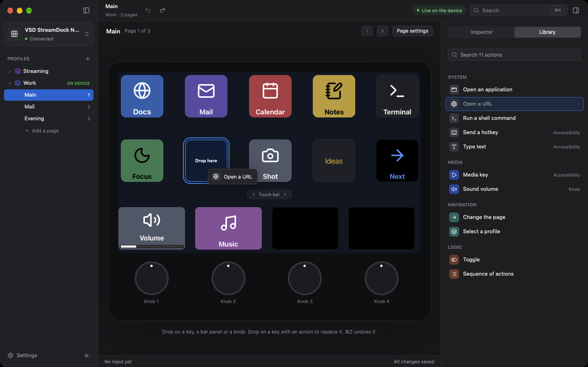

1. Click **Library** at the top of the right panel.
2. Push and hold the mouse button on an action kind, and move the pointer.
   The row of the kind gets a dashed border, and a small picture of the
   kind moves with the pointer.
3. Move the pointer onto a key face, a bar panel, or a knob. Only the
   control below the pointer gets a dashed blue border and the text
   "Drop here".
4. Release the mouse button.

The action goes on the first gesture of the control, with the default
settings of the kind: **Press** for a key, **Tap** for a bar panel, and
**Turn** for a knob. This is also true when a different card of the control
is open. The drop selects the control and opens the card of that gesture.
The status bar shows the change, for example "Key 9 gets “Open a URL” for
Press". The right panel stays on **Library**.

- If the gesture has an action already, the new action replaces it. One
  Command-Z (**Undo Drop Action**) gets the old action back.
- If you release the mouse button outside a control, nothing changes.
- During the drag, the line of help below the device tells where you can
  drop the action.

To find a kind, type a part of its name in the search field at the top of
the library, for example `text`. The library then shows only the kinds with
that text in their names. If no kind agrees, it shows "No action matches"
and your text. To see all kinds again, delete the text.

## The settings of an action

The open card of a gesture shows the settings of its action, one setting on
each row. The control of a setting agrees with its type:

| Type of setting | Control |
|---|---|
| Text | A text field. Some text fields have three lines or more. |
| Number | A small text field for digits. A number out of the range changes to the nearest permitted number. |
| Selection | A button with the selected value. Click it, and click a value in the menu. |
| Current selection | A menu that the action fills when the form opens. A saved value that is not available stays visible and stays in the profile. Open the form again to refresh the list. |
| Colour | The fill colour samples and a field for `#RRGGBB`. An incomplete value changes nothing. |
| On or off | A switch |
| Hotkey | A field that records a hotkey. See [Send a hotkey](#send-a-hotkey). |
| File or application | A text field and **Choose…** |
| Action | A card in the card, with its own action kind and settings. See [Toggle](#toggle). |
| List of actions | A list of steps above the other settings. See [Sequence of actions](#sequence-of-actions). |

If a setting has a long name, the name is above the control.

This test form shows a current selection and a colour field:

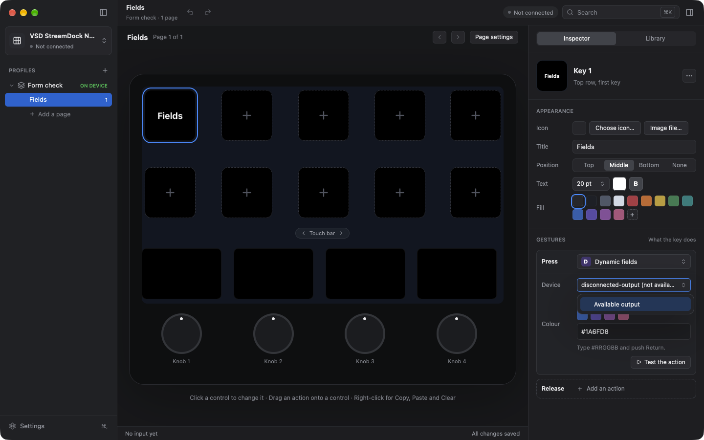

## Test an action

You can run the action of a gesture with no push on the device.

1. Click the card of the gesture to open it.
2. Click **Test the action** at the end of the card.

OpenCraft runs the action in the same way as when you do the gesture on the
device. The status bar shows, for 4 seconds, which action OpenCraft tests, for
example "Testing “Open a URL” of Key 8 for Press".

- If the action fails, the window shows a message above the status bar. See
  [Messages in the window](faults.md#messages-in-the-window).
- If the action needs the Accessibility permission and OpenCraft does not
  have it, you get the same message as from the device. See
  [Give the Accessibility permission](install.md#give-the-accessibility-permission).
- The test uses the settings that the card shows now.
- A test does not change the profile. **Undo** does not undo a test.
- A card of an action that is not available has no button.

## An action that is not available

A profile can contain an action that this version of OpenCraft does not
have, for example from a newer version. Then the button of the card shows
**Not available**. The card shows the identifier of the action kind, and the
text "This version of OpenCraft does not have this action. The binding
stays in the profile."

- OpenCraft keeps the action and its settings in the profile.
- To use a different action, click **Not available**, and click an action
  kind. To remove the action, click **Remove the action**.

## How OpenCraft checks a setting

OpenCraft saves each change immediately, as in
[Configure a key](first-key.md#how-opencraft-saves-your-changes).

- OpenCraft does not check a setting when you type it. It checks the
  setting when you operate the control. If OpenCraft cannot use a setting,
  the window shows a message above the status bar. See
  [Messages in the window](faults.md#messages-in-the-window).

## Open an application

| Setting | What to give |
|---|---|
| Application, file, or folder | The name of an application, for example `Safari`, or the path of an application, a file, or a folder |
| Arguments | Optional. Words that macOS gives to the application when it starts the application |

1. Type the name of the application. Or click **Choose…** and select an
   application, a file, or a folder in the file dialog. You can also type
   the path of a folder. A path can start with `~/` for your home folder.
2. If the application needs arguments, type them in the field
   **Arguments**.

- A name with no `/` is the name of an application. A path that ends with
  `.app` is an application. Each other path is a file or a folder. macOS
  opens a file in its default application, and a folder in Finder.
- If the application runs, macOS brings it to the front. It does not start
  the application again.
- Separate the arguments with spaces. Use `"` or `'` around an argument that
  has spaces, for example `--profile "Work Profile"`. A `\` before a `"`,
  `'`, `\` or space gives that character.
- macOS gives the arguments to an application only when it starts the
  application. If the application already runs, it does not get them.
- Arguments work only with an application. If you give arguments for a file
  or a folder, the window shows a message and OpenCraft opens nothing.
- Old profiles load with no change. They have no arguments.

## Quit an application

| Setting | What to give |
|---|---|
| Application | The name of an application, for example `Calculator`, its bundle identifier, or the path of an application |
| Force quit | On to end the application at once. Off to ask it to quit. |

1. Type the name of the application. Or click **Choose…** and select the
   application in the file dialog.
2. Keep **Force quit** Off, unless the application does not answer.

- With **Force quit** Off, OpenCraft asks the application to quit, as the
  Quit menu item does. The application can ask you to save your work, and it
  can refuse. Then it keeps running.
- With **Force quit** On, macOS ends the application at once. The application
  loses its unsaved work.
- If the application does not run, the window shows a message.
- OpenCraft quits each application that matches the name, and never itself.
  It does not stop system processes.
- This action asks for no new permission.

## Open a URL

| Setting | What to give |
|---|---|
| URL | A full URL, for example `https://example.com` |
| Browser | Optional. The name of an application, for example `Firefox`, or the path of an application |

1. Type the URL.
2. To use a browser that is not the default browser, type its name in the
   field **Browser**. Or click **Choose…** and select the application.

If the field **Browser** is empty, macOS opens the URL in the default
application for that type of URL. If you name an application, macOS opens
the URL in that application, and brings it to the front. Old profiles have
no browser, so they use the default application.

## Run a shell command

| Setting | What to give |
|---|---|
| Command | One or more lines for the shell `/bin/sh` |

- OpenCraft does not show the output of the command.
- OpenCraft does not wait for the command. You can operate a different
  control while the command runs.
- If the command ends with an error code, the window shows the message
  "The shell command ends with code N."
- OpenCraft can have a short search path for programs, for example after a
  start from the Finder or at login. Thus give the full path of a program
  that is not in `/usr/bin` or `/bin`.

## Send a hotkey

| Setting | What to give |
|---|---|
| Hotkey | A key with modifiers, or modifiers only. Left and right Control, Option, Shift and Command, and Fn are available. |

1. Click the field **Record hotkey…**. The field gets a blue frame and shows
   "Push a key…".
2. Push the key combination on the keyboard of the computer, for example
   Shift-Command-4.
3. The field shows the hotkey with symbols, in the order of macOS, for
   example "⇧⌘4". The order is Control (⌃), Option (⌥), Shift (⇧), and
   Command (⌘), and then the key.

For modifiers only, push the modifiers and release them all. The record
completes on release. A right-side modifier has `R` before its symbol, for
example `R⌃` for right Control. Fn shows as `Fn`.

To cancel the record, push Esc. To remove the hotkey, click **Clear**.

OpenCraft sends the hotkey to the application in front.

These keys are possible: the letters, the digits, F1 to F20, Return, Tab,
Space, Delete, Forward Delete, Esc, the arrow keys, Home, End, Page Up,
Page Down, and the punctuation keys. You cannot record Esc with no modifier
key, because Esc cancels the record. A hotkey sends a complete push and
release, not a hold. Old profiles keep their behaviour. Some applications
do not accept a synthetic Fn event.

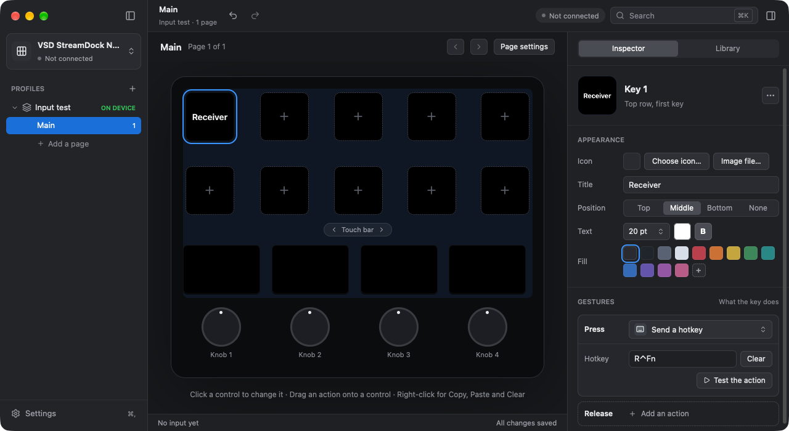

## Mouse event

| Setting | What to give |
|---|---|
| Operation | Click, double click, move to position, move by offset, scroll in one of four directions or drag to position |
| Button | Left, right or middle; for click, double click and drag only |
| X, Y | Position or offset in screen points; for move and drag only |
| Scroll step | 1 to 1000 lines for each input; for scroll only. The default is 3. |

Click and double click operate at the pointer. Drag starts at the pointer,
moves to X, Y and releases the button. An absolute position uses the top
left of the main screen as 0, 0. X increases to the right; Y increases down.
Other screens can have negative positions. A relative move adds X, Y to
the current pointer position.

For a knob, the joined **Turn** card scrolls down for a right turn and up
for a left turn. **Scroll step** sets the number of lines for each turn.
To choose another operation for each direction, click **Set left and right
apart**. To scroll horizontally, set the two directions apart and select
**Scroll left** and **Scroll right**.

Mouse events operate in the application under the pointer. Put the pointer
at the target before you operate the device. **Test the action** uses the
pointer position at that button, not a target in another application. A
test click cannot invoke its own test command again.

This action uses only the Accessibility permission.

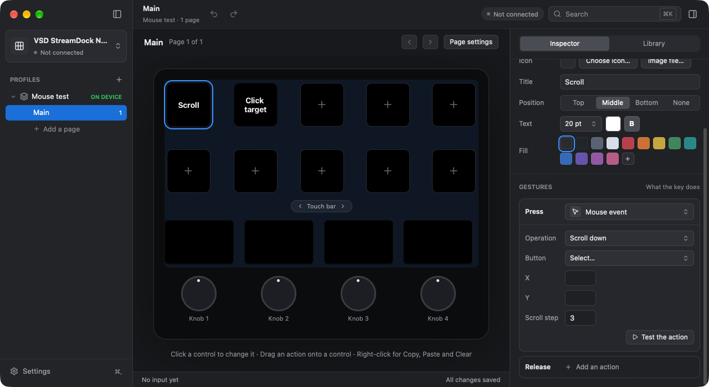

## Mac system function

| Setting | What to give |
|---|---|
| Function | Mission Control, Launchpad, Screenshot, Screen saver, Sleep, Lock or Show desktop |

- **Mission Control** shows the open windows. Push Esc to close it.
- **Launchpad** opens Launchpad on earlier macOS, or Apps on macOS 26 and
  later. Push Esc to close it.
- **Screenshot** opens the system screenshot controls. Choose the area and
  capture option there, or push Esc to cancel. OpenCraft saves no picture.
- **Screen saver** starts the screen saver. Move the pointer or push a key
  to return. macOS can ask for the login password.
- **Sleep** requests computer sleep, not only display sleep. Push a key or
  use the power button to wake the computer.
- **Lock** locks the screen. Sign in again to return.
- **Show desktop** moves the windows aside. Invoke it again to restore them.

Save your work before you test Sleep, Lock or Screen saver. These choices
take effect at once; there is no confirmation in OpenCraft. Do not test
them while another person or process needs this session.

This kind uses the existing Accessibility permission. It asks for no
Automation or Screen Recording permission. Some choices use the default
system shortcuts. If you changed those shortcuts, use **Send a hotkey**
with your own combination instead. Do Not Disturb is not available.
The calls and their verification limits are in the
[knowledge base](../kb/macos-system-functions.md).

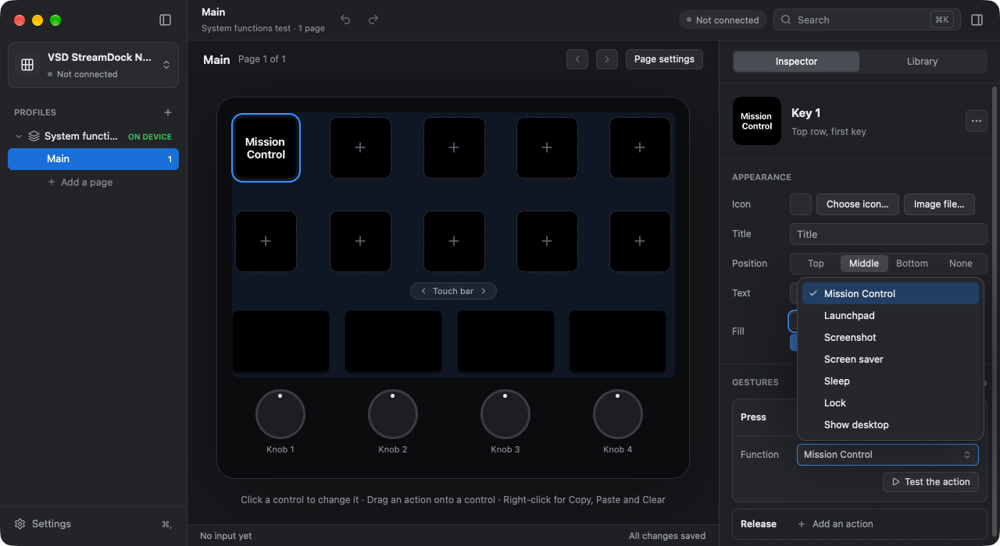

## Type text

| Setting | What to give |
|---|---|
| Text | One or more lines of text |
| Paste with clipboard | On to paste long text with Command-V. Off to type it. |
| Press Return after | On to press Return after the text. |

OpenCraft types the text into the application in front. The text can have
letters with accents, currency signs, and emoji. Both switches are Off in
old profiles. Paste mode keeps all clipboard formats and puts them back
300 ms after the paste. If another application changes the clipboard in
that time, OpenCraft keeps that new content. An application that reads the
clipboard later can miss the paste. Use typing mode for that application.

## Media key

| Setting | What to give |
|---|---|
| Key | Play or pause, Next, Previous, Fast forward, Rewind, Volume up, Volume down, or Mute |

OpenCraft sends the media key, as the media keys of a keyboard do.

- Fast forward and Rewind are the keys F9 and F7 of a Mac keyboard. The
  media application decides what they do. Some applications skip a track.
  Other applications move in the track while the key is down. OpenCraft
  sends one short press.
- There is no Stop key. macOS has no system key for Stop, so OpenCraft
  cannot send it. Use Play or pause to stop a player.
- A profile that you made before these keys existed does not change.

## Sound volume

| Setting | What to give |
|---|---|
| Operation | Up, Down, or Mute. The default is Up. |
| Step | The change for each operation, from 1 to 25 percent. The default is 5. |

- This action changes the volume of the default sound output directly. It
  does not need the Accessibility permission.
- Mute changes between muted and not muted. Up and Down also stop the mute.
- The key face or the bar panel of the binding shows the volume as a bar
  at the bottom. When the sound is muted, it shows "Muted". OpenCraft reads
  the volume again each 2 seconds, thus the bar also shows a change that you
  make with a different method.
- A good use is a knob: set **Sound volume** on "Turn", and Mute on "Push".
  The "Turn" card sets Up for a turn to the right and Down for a turn to the
  left. See [The Turn card](controls.md#the-turn-card). The bar shows on the
  bar panel above the knob.

## Device brightness

This action changes the displays of the controller, not the computer display.
It is in the **Device** group. No Accessibility permission is necessary.

- **Up** or **Down** changes the brightness by **Step** percentage points.
  The default step is 5. The value stops at the limits of the device.
- **Set value** uses **Brightness**. Values below the lowest brightness of
  the model use that lowest brightness. On the N4 Pro it is 15 %. Brightness
  0 does not switch off the display: use **Screen off** for that.
- On a knob, assign this kind to **Turn**. Right goes up and left goes down.
  On a key, select Up, Down or Set value.

The new value shows in the device inspector, in **Device settings**, and in
the menu bar brightness slider. OpenCraft saves it for the next start. The
knob lights do not change. The action does not wake a dark or locked device.

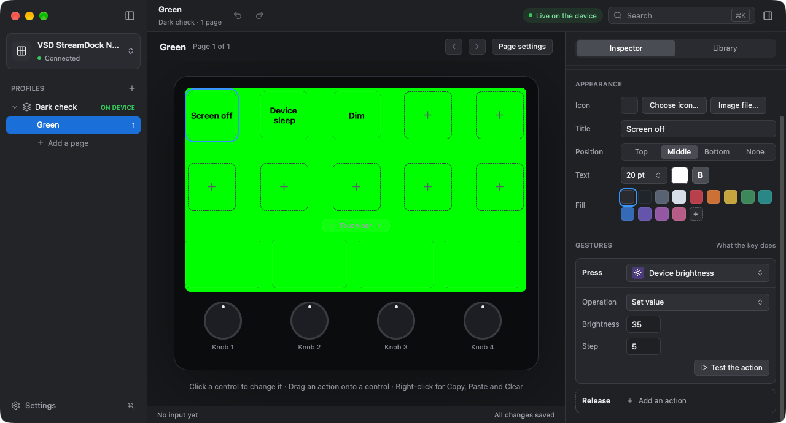

## Screen off and Device sleep

These kinds are in the **Device** group of the library. They have no settings.
They do not change the saved brightness.

- **Screen off** makes the displays and knob lights dark. OpenCraft keeps
  the connection and its keep-alive in operation.
- **Device sleep** makes them dark and stops the device keep-alive timer.
  Use this when you do not need the device for a time.

To wake either state, select **Wake Device** in the menu bar item or open the
OpenCraft window. The full profile and stored settings return. A device input
report also wakes it, if the firmware sends that report while dark. That
first gesture, including its release, does not run an action. Whether this
firmware sends input after sleep is not verified. Do not rely on a device
key as the only wake path. While the screen is locked, no wake or device
action can override the lock. See
[Sleep and screen lock](background.md#sleep-and-screen-lock).

## Sound output

Group: **Media**. A push changes the default sound output of the Mac. The
key shows the name of the current sound output. The action does not change
the output for the sound effects of the system. A program that uses its own
output can keep that output.

The field **Operation** has two values:

- **Set device**: the action sets the output of the field **Device**.
  Select one output in the menu of the field.
- **Next device**: the action sets the next output of the field **Cycle
  list**. In the menu of the field, click an output to add it at the end of
  the list. Click it again to remove it. After the last output of the list,
  the action sets the first output. If the current output is not in the
  list, the action sets the first available output of the list. If the list
  is empty, the action uses all current outputs.

An output that is not connected stays in the settings and shows "not
available". **Next device** skips it. If no output of the list is
available, or if the output of **Set device** is not available, the action
shows a message and changes nothing. The menu shows the outputs at the time
when the form opens. To see a new output, select a different control and
then select this control again.

When another program changes the output, the key shows the new name. The
action asks for no new permission.

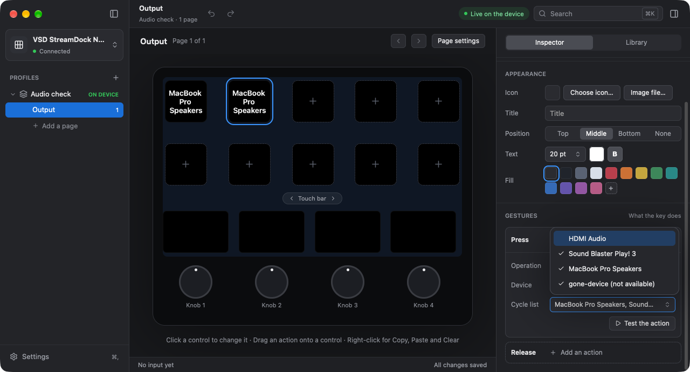

## Microphone mute

Group: **Media**. This action has no settings. A push switches the mute of
the default sound input of the Mac. The key shows **Microphone muted** with
a frame, or **Microphone on** with no frame. A change from another program
also changes the key. The action follows a change of the default input.

A device with no writable master mute shows **Not supported**. OpenCraft
does not set its input volume to zero as a substitute. It opens no input
stream, records no sound and asks for no microphone permission.

Use **Test the action** to switch mute without a push on the device. Test
again to put the previous mute state back.

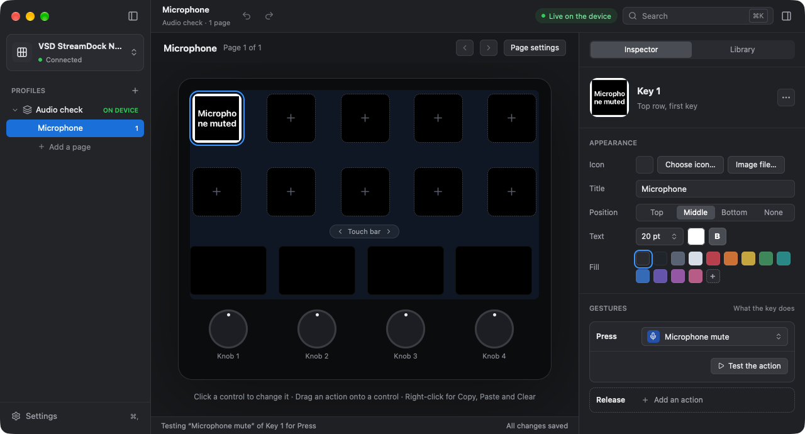

## Change the page

| Setting | What to give |
|---|---|
| Page | Next page, Previous page, or Page number. The default is Next page. |
| Page number | The number of the page, from 1. OpenCraft uses it only for "Page number". |

- After the last page, "Next page" goes to the first page. Before the first
  page, "Previous page" goes to the last page.
- If the profile has no page with that number, the window shows a message.

Pages are in [Knobs, touch bar, pages, and profiles](controls.md#pages).

## Select a profile

| Setting | What to give |
|---|---|
| Profile name | The name of a profile, as the sidebar shows it |

- The device shows the first page of that profile.
- If no profile has that name, the window shows a message.
- If two profiles have the same name, OpenCraft selects one of them. Give
  each profile a different name.

Profiles are in
[Knobs, touch bar, pages, and profiles](controls.md#profiles).

## Toggle

A toggle has two states, on and off. Each operation of the control changes
the state, and does the action for the new state.

| Setting | What to give |
|---|---|
| From Off to On | The action to do when the state changes to on |
| From On to Off | The action to do when the state changes to off |
| Label for on | Optional. The label that the surface shows in the state on. |

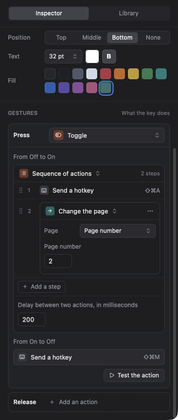

The card of the toggle shows each action as a card in the card:

1. Below "From Off to On", click **Add an action**. Select an action kind.
   The card of the new action opens.
2. Set the settings of that action on its card.
3. Do the same steps below "From On to Off".

- A closed card shows the action kind and a short value, for example the
  keys of a hotkey. Click the card to open it. Click the top row of an open
  card to close it.
- To change the action kind, click the kind name at the top of the open
  card, and select a different kind. To remove the action, select **Remove
  the action**.

**Appearance for each state.** When the action of **Press** of a key, or
of **Tap** of a bar panel, is a toggle, the inspector shows the section
"Appearance for each state" in place of "Appearance".

- The section shows the face **Off** and the face **On** next to each other,
  as the device shows them. The face of the state now has the text "· now".
  The second line of the inspector header also shows the state, for example
  "Toggle · the state now is Off".
- Click **Off** to change the image, the title, the look of the title, and
  the fill of the key.
- Click **On** to change the label for on in **Title**. The face On uses the
  fill and the image of the face Off, with a frame.

Notes:

- A toggle starts in the state off. Thus the first operation does the
  action for on.
- In the state on, the key face or the bar panel shows a frame. The frame
  has the colour of the title.
- OpenCraft keeps the state while it runs. When OpenCraft starts again, each
  toggle is off.
- If you change the settings of a toggle, its state becomes off.
- A toggle does not read the state of the computer. If you change the same
  thing with a different method, the state of the toggle can be incorrect.
  Then operate the control again.

## Sequence of actions

A sequence does a list of actions, one after the other. Each action is a
step.

| Setting | What to give |
|---|---|
| The steps | The list of actions, in their order |
| Delay before, in milliseconds (in each open step) | From 0 to 10000. The wait before this step starts. |
| Delay between two actions, in milliseconds | The default for a step with no delay of its own. The default is 100. |

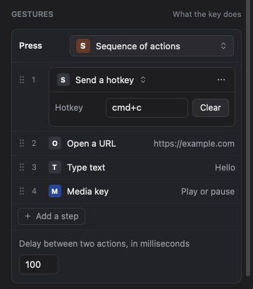

The card of the sequence shows one row for each step: a handle, the number,
the action kind, and a short value.

1. Click **Add a step**. Select an action kind. The new step opens.
2. Set **Delay before, in milliseconds** and the action settings on its card.
3. Do steps 1 and 2 again for each action.

- Click a step to open it. Click the top row of the open step to close it.
- To move a step, drag its handle (six dots) to a different row. You can
  also right-click the step, and click **Move Up** or **Move Down**.
- To remove a step, right-click it and click **Remove**. An open step also
  has the button **⋯** with the same menu.
- The delay of a step is **before** the step. There is no wait after the
  last step.
- A new step gets the value of **Delay between two actions** as its delay.
  A new first step gets 0.
- Each step keeps its delay when you move it or change its action kind.
  Copy and paste of the control, and undo, keep all step delays.
- A sequence from an older version of OpenCraft keeps its timing: the first
  step starts at once, and each later step waits for **Delay between two
  actions**. You can change the delay of each step.

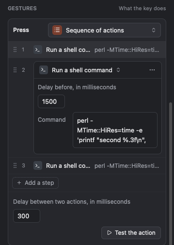

- Each change is one step of the undo history, for example "Undo Move Step".
  Push Command-Z to undo it.

Notes:

- The sequence does not wait until an action is complete. The delay is the
  only wait. For an action that needs time, for example the start of an
  application, set a longer delay before the next step.
- A sequence and a toggle can contain each action kind, also a different
  toggle or sequence. For example, the action "From Off to On" of a toggle
  can be a sequence.
