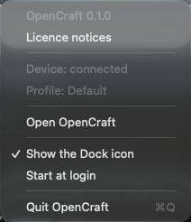

# Operation in the background

OpenCraft operates the device also when its window is closed. You need the
window only to change the settings.

## Close the window

Close the window as usual, for example with the red button at the top left.
OpenCraft continues to run. The device continues to operate, and each action
continues to operate.

To quit OpenCraft, use **Quit OpenCraft** in the menu bar item, or push
Command-Q while the window is in front. When OpenCraft quits, the displays and
the knob lights of the device become dark. The device stays dark until
OpenCraft starts again.

## The menu bar item

OpenCraft puts an item with a grid symbol in the menu bar. Click it to see
the menu.

| Menu item | What it does |
|---|---|
| OpenCraft *version* | Shows the version of OpenCraft. You cannot click it. |
| Device: connected, or Device: not connected | Shows the state of the device. You cannot click it. |
| Profile: *name* | Shows the active profile. You cannot click it. |
| Open OpenCraft | Opens the window, or brings it to the front |
| Show the Dock icon | Shows or hides the Dock icon. See below. |
| Start at login | Starts OpenCraft when you log in. See below. |
| Quit OpenCraft | Quits OpenCraft. The device becomes dark. |

When the Dock icon shows, a click on the Dock icon also opens the window.

## The Dock icon

The Dock icon shows by default. To hide it:

1. Click the menu bar item.
2. Click **Show the Dock icon**. The check mark goes away.

The window stays open. OpenCraft keeps this option for the next start. To
show the Dock icon again, do the same steps.

With no Dock icon, OpenCraft is also not in the list of Command-Tab. Use the
menu bar item to open the window.

## Start at login

1. Click the menu bar item.
2. Click **Start at login**. The item gets a check mark.

When you log in, OpenCraft starts with no window. The menu bar item shows,
and the device operates. To open the window, use **Open OpenCraft** in the
menu bar item.

To stop the start at login, click **Start at login** again. The check mark
goes away.

- The option writes the file `~/Library/LaunchAgents/opencraft.login.plist`.
  The file contains the location of OpenCraft. If you move OpenCraft to a
  different folder, the check mark goes away. Click **Start at login**
  again.
- The option operates only when OpenCraft is in a folder on your disk, for
  example the Applications folder. If you start OpenCraft from the
  downloaded disk image, OpenCraft shows a message and does not turn the
  option on.
- macOS can show a message that a background item was added. System
  Settings > General > Login Items can show the item with the name
  `opencraft`.
- If you turn off the item in System Settings, the menu still shows the
  check mark. Use the menu of OpenCraft to change the option.

## One OpenCraft at a time

Only one OpenCraft can run at a time. If OpenCraft already runs, a second
start does not open a second OpenCraft. The OpenCraft that runs opens its
window. This occurs for a start from the Finder, from the Dock, and from the
Terminal. A second start from the Terminal also writes "OpenCraft is
already running." and stops.

A start at login does not open the window. You can also open the window of
the OpenCraft that runs with the menu bar item.

## The files of OpenCraft

OpenCraft keeps its files in the folder
`~/Library/Application Support/OpenCraft`. To open the folder, in the Finder,
click Go > Go to Folder, and type the path.

| File or folder | Contents |
|---|---|
| `profiles/` | The profiles folder |
| `profiles/<name>/` | One profile: the file `profile.toml` and the folder `images` with the images of the profile |
| `profiles/state.toml` | The active profile |
| `profiles/device-settings.toml` | The device settings |
| `profiles/removed/` | The profiles that you removed |
| `shell.toml` | The option for the Dock icon |
| `opencraft.log` | The log file. See below. |
| `opencraft.log.1` | The previous log file |
| `opencraft.lock` | The file that prevents a second OpenCraft. It contains the process number of the OpenCraft that runs. |

- The name of a profile folder comes from the name of the profile when you
  make it. It does not change when you rename the profile.
- To make a backup of a profile, copy its folder. To make a backup of all
  profiles, copy the folder `profiles`.
- To get a removed profile back: quit OpenCraft, move its folder from
  `removed` to `profiles`, and start OpenCraft.
- Do not change these files while OpenCraft runs. OpenCraft does not see the
  change, and it can write over it.

## The log file

When OpenCraft starts from the Finder, from the Dock, or at login, it writes
its messages to `opencraft.log`. The file contains the time of each start,
each connection and disconnection of the device, and each message that the
window shows. For a problem with the device, it also contains the technical
cause. It does not contain the gestures that you do on the device.

When the file is larger than 1 MiB at a start, OpenCraft renames it to
`opencraft.log.1` and starts a new file.

When you report a fault, attach the log file. Read it first, and remove
personal data if you find some, for example a folder name.
