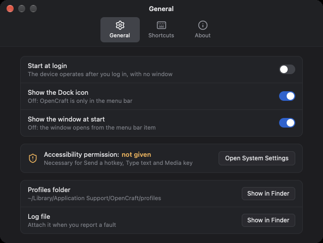
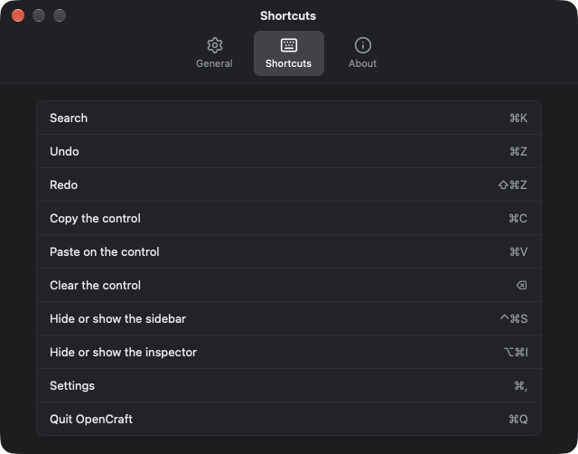
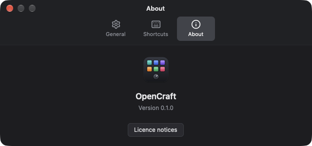

# Operation in the background

OpenCraft operates the device also when its window is closed. You need the
window only to change the settings.

## Close the window

Close the window as usual, for example with the red button at the top left.
OpenCraft continues to run. The device continues to operate, and each action
continues to operate.

To quit OpenCraft, use **Quit OpenCraft** in the menu bar item, or push
Command-Q while a window of OpenCraft is in front. When OpenCraft quits, the
displays and the knob lights of the device become dark. The device stays dark
until OpenCraft starts again.

## The menu bar item

OpenCraft puts an item with a grid symbol in the menu bar. Click it to see
the menu. You can change the profile, the page, and the brightness of the
displays with the menu. The window does not have to be open.

| Menu item | What it does |
|---|---|
| *Device name* · connected, or *Device name* · not connected | Shows the state of the device. The dot is green when the device is connected. You cannot click it. |
| Profile, and the list of your profiles | Click a profile to make it the active profile. The device shows it. The check mark is at the active profile. |
| Page: *name* | Opens a list of the pages of the active profile. Click a page to show it on the device. The check mark is at the active page. |
| Brightness | The slider sets the brightness of the displays of the device. Drag the knob of the slider. The number at the right shows the value. OpenCraft saves the value and uses it again when it starts. The same value shows in **Device settings** in the window. |
| Open OpenCraft (⌘O) | Opens the window, or brings it to the front; wakes the device |
| Wake Device | Wakes the device without opening the window |
| Settings… (⌘,) | Opens the Settings window. See below. |
| About and licence notices | Opens the Settings window at the tab **About** |
| Quit OpenCraft (⌘Q) | Quits OpenCraft. The device becomes dark. |

The key equivalents ⌘O, ⌘, and ⌘Q work while the menu is open. If the window
is open, it shows each change at once. For example, it shows the new active
profile in the sidebar.

When the Dock icon shows, a click on the Dock icon also opens the window.

## Sleep and screen lock

When the computer locks its screen or turns off its displays, OpenCraft makes
the device dark. While the screen is locked, device input does not run an
action. An unlock or a display wake restores the profile and the stored
brightness. A display wake does not override a screen lock.

Before computer sleep, OpenCraft saves pending changes and stops the device.
At wake it draws the full profile again. If the device stays dark, select
**Wake Device** in the menu bar item or open the OpenCraft window. These steps
do not override a screen lock or computer sleep.

## The Settings window

The Settings window holds the options of OpenCraft. To open it, do one of
these steps:

- Click the menu bar item, and click **Settings…**.
- In the window of OpenCraft, click **OpenCraft** in the menu bar of macOS,
  and click **Settings…**. Or push Command-comma (⌘,).
- In the window of OpenCraft, click **Settings** at the bottom of the
  sidebar.

If the Settings window is already open, these steps bring it to the front. The
menu item **About OpenCraft** and the item **About and licence notices** in
the menu bar item open the window at the tab **About**.

The window has three tabs: **General**, **Shortcuts**, and **About**. It opens
at the tab that you used last. You cannot change the size of the window. To
close it, click the red button at the top left, or push Command-W. The
OpenCraft window and the device continue to operate.

### The tab General

The three switches at the top of the tab:

| Switch | What it does |
|---|---|
| Start at login | Starts OpenCraft when you log in, with no window. See [Start at login](#start-at-login). |
| Show the Dock icon | Shows or hides the Dock icon. See [The Dock icon](#the-dock-icon). |
| Show the window at start | Opens the OpenCraft window when you start OpenCraft. See [The window at start](#the-window-at-start). |

Below the switches, the tab shows the state of the Accessibility permission.
The text is "Accessibility permission: **given**" or "Accessibility
permission: **not given**". Below it, the tab names the action kinds that need
the permission, for example "Necessary for Send a hotkey, Type text and Media
key". Click **Open System Settings** to open the pane Accessibility of System
Settings. OpenCraft also asks macOS for the permission, so that OpenCraft is in
the list of that pane. Turn on OpenCraft in the list. The text in the tab
changes to "given" when you do this. See
[Give the Accessibility permission](install.md#give-the-accessibility-permission).

At the bottom, the tab has two rows with the button **Show in Finder**:

| Row | What the button shows |
|---|---|
| Profiles folder | The folder with your profiles. The row shows its path. |
| Log file | The log file `opencraft.log`. See [The log file](#the-log-file). If the file does not exist yet, the button shows the folder that has it. |

### The tab Shortcuts

The tab lists the key commands of the OpenCraft window with their keys, for
example **Undo** with ⌘Z and **Hide or show the sidebar** with ⌃⌘S. You
cannot change the keys.

### The tab About

The tab shows the name of OpenCraft and its version. The button **Licence
notices** opens the licences of the software that OpenCraft contains, in
TextEdit or in your default text editor. If OpenCraft does not run from its
application package, for example after a build from the source code, the button
is dim, and the tab names the file that has the notices.

If a change in the Settings window fails, a red message shows at the bottom of
the window. Click **Close** to remove it.

## The Dock icon

The Dock icon shows by default. To hide it:

1. Open the Settings window. See above.
2. In the tab **General**, turn off **Show the Dock icon**.

The window stays open. OpenCraft keeps this option for the next start. To
show the Dock icon again, turn the switch on.

With no Dock icon, OpenCraft is also not in the list of Command-Tab. Use the
menu bar item to open the window.

## Start at login

1. Open the Settings window. See above.
2. In the tab **General**, turn on **Start at login**.

When you log in, OpenCraft starts with no window. The menu bar item shows,
and the device operates. To open the window, use **Open OpenCraft** in the
menu bar item.

To stop the start at login, turn off the switch.

- The option writes the file `~/Library/LaunchAgents/opencraft.login.plist`.
  The file contains the location of OpenCraft. If you move OpenCraft to a
  different folder, the switch goes off. Turn it on again.
- The option operates only when OpenCraft is in a folder on your disk, for
  example the Applications folder. If you start OpenCraft from the
  downloaded disk image, OpenCraft shows a message and does not turn the
  option on.
- macOS can show a message that a background item was added. System
  Settings > General > Login Items can show the item with the name
  `opencraft`.
- If you turn off the item in System Settings, the Settings window still shows
  the switch as on. Use the switch in the Settings window to change the option.

## The window at start

By default, OpenCraft opens its window each time that you start it. To start
OpenCraft with no window, turn off **Show the window at start** in the tab
**General**. Then use the menu bar item to open the window.

A start at login never opens the window. This does not depend on this switch.

## One OpenCraft at a time

Only one OpenCraft can run at a time. If OpenCraft already runs, a second
start does not open a second OpenCraft. The OpenCraft that runs opens its
window. This occurs for a start from the Finder, from the Dock, and from the
Terminal. A second start from the Terminal also writes "OpenCraft is
already running." and stops.

A start at login does not open the window. You can also open the window of
the OpenCraft that runs with the menu bar item.

## The files of OpenCraft

OpenCraft keeps its files in the folder
`~/Library/Application Support/OpenCraft`. To open the folder, in the Finder,
click Go > Go to Folder, and type the path.

| File or folder | Contents |
|---|---|
| `profiles/` | The profiles folder |
| `profiles/<name>/` | One profile: the file `profile.toml` and the folder `images` with the images of the profile |
| `profiles/state.toml` | The active profile |
| `profiles/device-settings.toml` | The device settings |
| `profiles/removed/` | The profiles that you removed |
| `shell.toml` | The options of the Settings window, and the sizes of the panes of the window |
| `opencraft.log` | The log file. See below. |
| `opencraft.log.1` | The previous log file |
| `opencraft.lock` | The file that prevents a second OpenCraft. It contains the process number of the OpenCraft that runs. |

- The name of a profile folder comes from the name of the profile when you
  make it. It does not change when you rename the profile.
- To make a backup of a profile, copy its folder. To make a backup of all
  profiles, copy the folder `profiles`.
- To get a removed profile back: quit OpenCraft, move its folder from
  `removed` to `profiles`, and start OpenCraft.
- Do not change these files while OpenCraft runs. OpenCraft does not see the
  change, and it can write over it.

## The log file

When OpenCraft starts from the Finder, from the Dock, or at login, it writes
its messages to `opencraft.log`. The file contains the time of each start,
each connection and disconnection of the device, and each message that the
window shows. For a problem with the device, it also contains the technical
cause. It does not contain the gestures that you do on the device.

When the file is larger than 1 MiB at a start, OpenCraft renames it to
`opencraft.log.1` and starts a new file.

When you report a fault, attach the log file. Read it first, and remove
personal data if you find some, for example a folder name.
