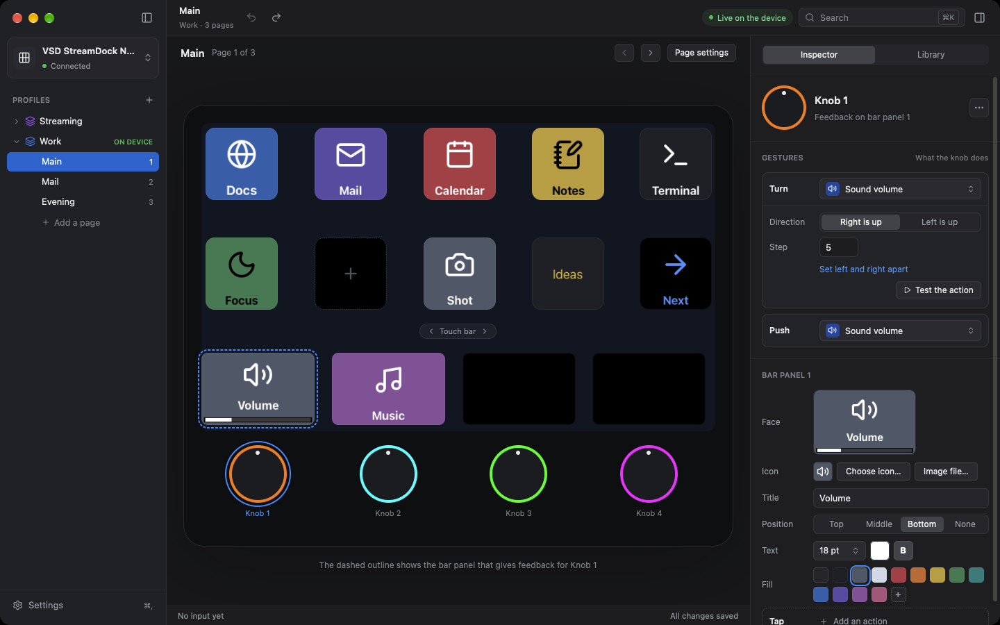
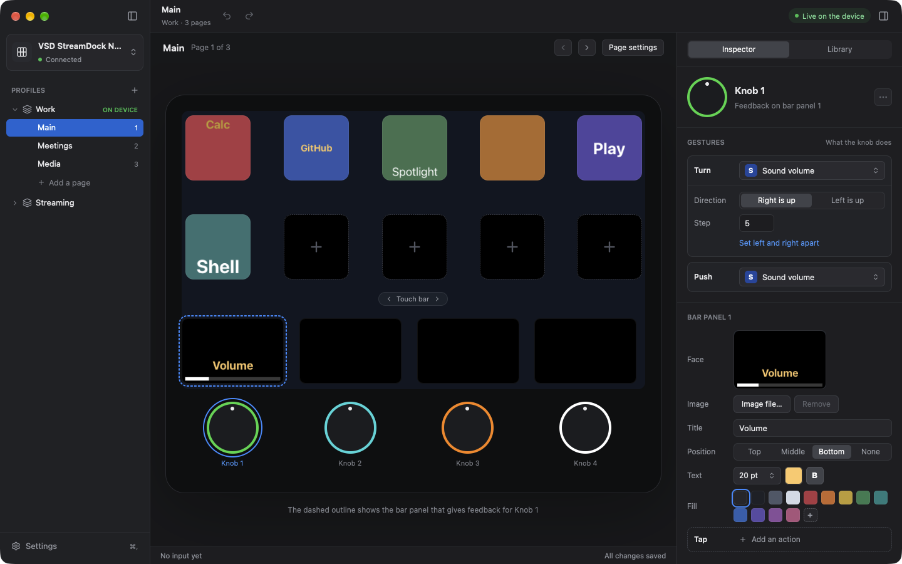
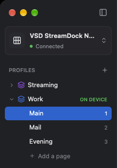
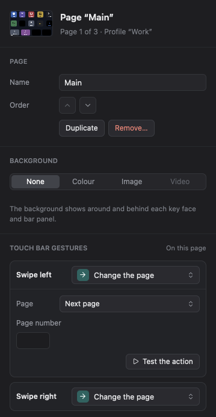
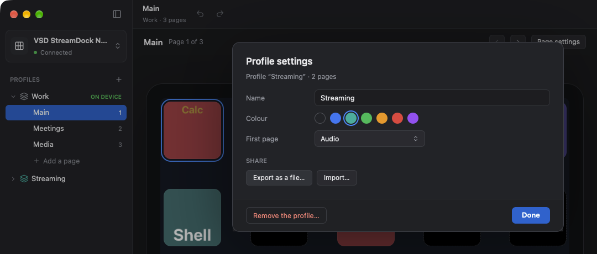
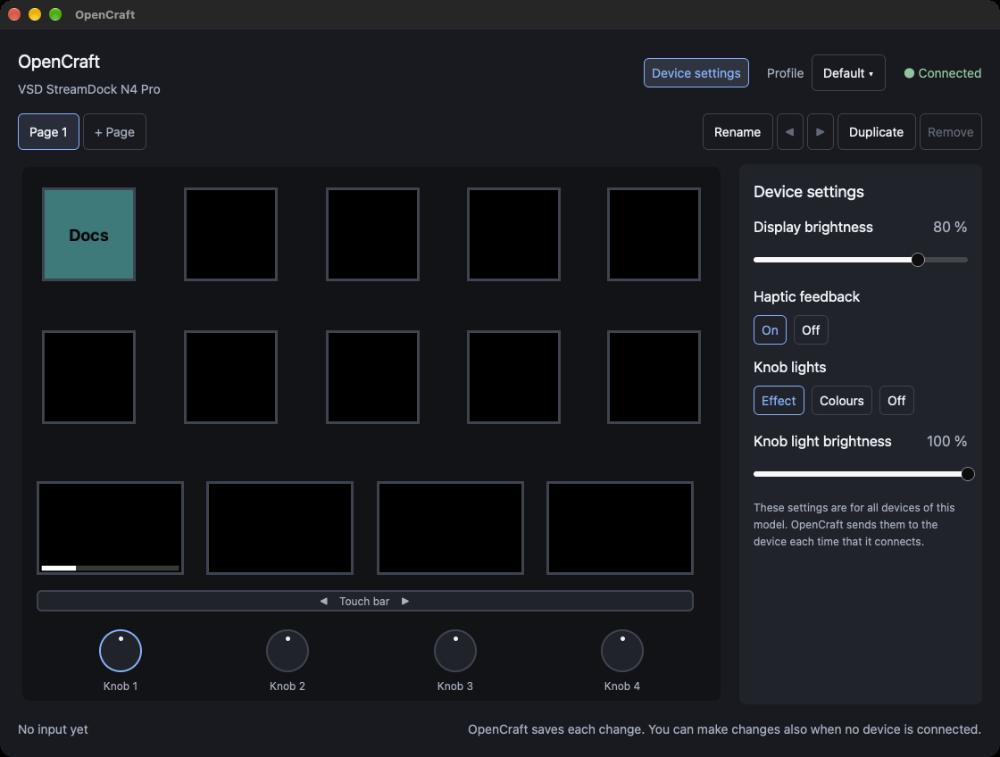

# Knobs, touch bar, pages, and profiles

## The gestures of each control

You select a control in the device picture. Then you set an action on the
card of a gesture, below **Gestures** in the inspector. Each gesture has its
own card, and each gesture can have a different action. The procedure is in
[Configure a key](first-key.md#4-set-an-action).

| Control | How to select it | Gestures |
|---|---|---|
| Key | Click its key face | Press, Release |
| Knob | Click the knob below the bar panels | Turn (Turn left and Turn right), Push. The inspector of a knob also shows the bar panel above it, with its Tap gesture. |
| Bar panel | Click the bar panel | Tap |
| Touch bar | Click the small control "◀ Touch bar ▶" above the bar panels. This selects the page: the swipes are part of the page. | Swipe left, Swipe right |

## The device picture

The canvas in the middle of the window shows the device. Each key face and
each bar panel is at its real position on the display of the device, and
shows the same image as the device. The knobs are below the bar panels.
Knob 1 is below bar panel 1.

| Part | What it shows |
|---|---|
| A blue outline | The selected control. At the start, the selected control is the key at the top left. |
| A thin blue outline | The control below the pointer |
| A dashed blue outline on a bar panel | The bar panel that gives feedback for the selected knob. The line below the device tells which knob. |
| A dashed border and a plus (+) on a key face | The key has no label, no colour, no image, and no action |
| The ring of a knob | The colour of the knob light, when the knob lights are set to **Colours**. Else the ring is grey. |
| A yellow glow | The control that you operate on the device now. A yellow dot shows where you touch the touch bar. |
| "◀ Touch bar ▶" | The control for the swipe gestures, between the keys and the bar panels. It is blue when the page is selected. |

Click an empty part of the canvas to select the page. The inspector then
shows the page. See [The page inspector](#the-page-inspector).

Above the device is the page header. It shows the name of the active page
and "Page 1 of 3", for example. At its right end are these buttons:

| Button | What it does |
|---|---|
| The arrow to the left (**Previous page**) | Shows the page before the active page. It is dim on the first page. |
| The arrow to the right (**Next page**) | Shows the page after the active page. It is dim on the last page. |
| **Page settings** | Selects the page, and shows the **Inspector** tab of the right panel |

The device shows the same page as the window. If the window is small, the
device picture is smaller, down to half of its full size.

## Knobs

1. Click a knob, for example **Knob 1**. The header of the inspector shows
   the bar panel that gives the feedback of the knob, for example "Feedback
   on bar panel 1".
2. On the **Turn** card, click **Add an action**, and set an action. See
   [Actions](actions.md). The action is for a turn to the left and for a
   turn to the right.
3. On the **Push** card, set the action for a push of the knob.

### The Turn card

The **Turn** card sets one action for the two turn directions. OpenCraft
keeps two actions in the profile: one for **Turn left** and one for **Turn
right**.

- Some actions have a direction, for example **Sound volume**. The card
  then shows the row **Direction**:
  - **Right is up**: a turn to the right makes the sound louder, and a turn
    to the left makes it quieter.
  - **Left is up**: the other way.
- A change to a setting on the card changes the two actions. One undo
  (⌘Z) removes the change from the two actions.
- An action with no direction gets the same settings for the two turns.

To set a different action for each direction, click **Set left and right
apart**. The inspector then shows the cards **Turn left** and **Turn
right**. The actions do not change. If the two actions agree again, the
cards show **Join left and right**. Click it to see the **Turn** card again.

The inspector shows the two cards also when the two actions are different,
for example when they have different settings, or when only one turn has
an action.

### The bar panel of a knob

Below the gestures, the section **Bar panel N** shows the bar panel above
the knob:

| Row | What it does |
|---|---|
| **Face** | Shows the image of the bar panel, as the device shows it |
| **Image**, **Title**, **Position**, **Text**, **Fill** | Change the bar panel, as in the **Appearance** section of a bar panel. See [Set the title and the fill](first-key.md#2-set-the-title-and-the-fill). |
| **Tap** | The card of the action for a tap on that bar panel |

Thus you can configure the knob and its bar panel in one inspector.

### How a knob operates

- Each click of a turn does the action one time. A fast turn does the action
  many times.
- A knob has no display. The action of a knob shows its result on the bar
  panel above the knob. For example, the sound volume shows a bar on bar
  panel 1 for knob 1.
- A knob has no "release" gesture.

The colours of the knob lights are device settings. See
[Device settings](#device-settings).

## The touch bar

The touch bar is one long touch display. OpenCraft shows it as four bar
panels. Each bar panel has its own label, colour, and image, as a key face
does.

There are two types of touch gesture:

| Gesture | Control | Where |
|---|---|---|
| Tap | One bar panel | The action of the bar panel that you touch |
| Swipe left, Swipe right | The touch bar | The same action on all of the touch bar. A swipe has no position. |

To set the action of a tap:

1. Click a bar panel in the device picture.
2. Set the label, the colour, the image, and the action, as for a key. See
   [Configure a key](first-key.md).

To set the action of a swipe:

1. Click the small control "◀ Touch bar ▶" above the bar panels. The
   inspector shows the page, and moves down to the cards **Swipe left** and
   **Swipe right** below **TOUCH BAR GESTURES**.
2. On one of the cards, click **Add an action**, and set an action. A good
   action for a swipe is "Change the page".

Sometimes the device does not identify a touch as a tap or as a swipe. Then
nothing occurs. Touch again.

## Pages

A page is one full set of key faces, bar panels, and bindings. The device
shows one page at a time. A profile has one page or more.

The sidebar at the left shows the pages of the active profile, below the
name of the profile. The number at the right of a page is its position. The
blue row is the active page. The name of the active page is also at the top
of the device picture.

| To do this | Do this |
|---|---|
| Show a different page on the device | Click the page in the sidebar |
| Add an empty page | Click **Add a page** below the pages. The new page becomes the active page. |
| Copy a page | Right-click the page, and select **Duplicate**. The copy goes after the last page and becomes the active page. |
| Give a page a different name | Double-click the page. Or right-click the page, and select **Rename**. Type the name, and push Return. |
| Move a page up or down in the list | Right-click the page, and select **Move Up** or **Move Down** |
| Remove a page | Right-click the page, and select **Remove…**. Then click **Remove**. A profile keeps one page at the minimum. |

When you edit a name, push Escape to keep the old name. A click outside the
name keeps the new name. A name cannot be empty.

You can also do these changes in the page inspector. See
[The page inspector](#the-page-inspector).

### The page inspector

The page inspector shows the settings of the active page. To show it, do
one of these steps:

- Click an empty part of the canvas.
- Click **Page settings** in the page header.
- Click the small control "◀ Touch bar ▶". The inspector then moves down to
  the swipe gestures.

The header shows a small picture of the page, the name of the page, and
"Page 2 of 3 · Profile “Work”", for example.

| Part | What it does |
|---|---|
| **Name** | The name of the page. Type a name, and push Return or click outside the field. Push Escape to keep the old name. |
| **Order** | The arrow up moves the page up in the list. The arrow down moves the page down. An arrow is dim on the first or the last page. |
| **Duplicate** | Adds a copy of the page |
| **Remove…** | Asks for a confirmation, and then removes the page. It is dim when the profile has one page only. |
| **TOUCH BAR GESTURES** | The cards **Swipe left** and **Swipe right** of this page. See [The touch bar](#the-touch-bar). |

⌘Z undoes each of these changes. One edit of the name is one step.

When you click a page, the device shows that page also. To change the
page from the device, set the action "Change the page" on a control. Use the
same control on each page, so that you can always go to the next page. See
[Change the page](actions.md#change-the-page).

Example: on each page, set "Swipe left" of the touch bar to "Next page", and
"Swipe right" to "Previous page".

To hide the pages of the active profile, click the arrow at the left of its
name. Click the arrow again to show them.

## Profiles

A profile is a named set of pages. You can use one profile for each type of
work, for example one for video calls and one for photos. The device shows
the active profile.

The sidebar shows all profiles below **PROFILES**. The active profile has
the mark **ON DEVICE**, and its pages are below it.

| To do this | Do this in the sidebar |
|---|---|
| Select a different profile | Click the name of the profile |
| Add an empty profile | Click **+** at the right of **PROFILES**. Type a name in the new row, and push Return. |
| Copy a profile | Right-click the profile, and select **Duplicate**. The copy has the name "*name* copy". |
| Give a profile a different name | Double-click the profile. Or right-click the profile, and select **Rename**. Type the name, and push Return. |
| Remove a profile | Right-click the profile, and select **Remove…**. Then click **Remove**. You cannot remove the last profile. |

- A new profile or a copy becomes the active profile.
- A double-click on a profile that is not active also makes it the active
  profile.
- OpenCraft does not delete a removed profile. It moves the profile to the
  folder `removed` in the profiles folder. To get it back, see
  [The files of OpenCraft](background.md#the-files-of-opencraft).
- To change the profile from the device, set the action "Select a profile"
  on a control. See [Select a profile](actions.md#select-a-profile).

### Profile settings

Right-click a profile in the sidebar, and select **Profile settings…**. A
sheet opens on the window. You can open the settings of each profile, also
of a profile that is not active. The window does not operate while the
sheet is open.

| Setting | What it does |
|---|---|
| **Name** | The name of the profile. The new name applies when you push Return, click **Done**, or click a different control. An empty name does not change the name. |
| **Colour** | The colour of the profile icon in the sidebar. The circle with no colour removes the colour. |
| **First page** | The page that the device shows when the profile becomes the active profile, also when OpenCraft starts. If you remove this page, the first page in the list is the first page again. |

- Each change applies at once. Edit > Undo can undo a change of the first
  page of the active profile. It cannot undo a change of the name or of the
  colour.
- Click **Done**, or push Return or Escape, to close the sheet.
- **Remove the profile…** asks for a confirmation, and then removes the
  profile, as **Remove…** in the sidebar does.

### Export and import a profile

You can put a profile in one file, for example to keep a copy or to give
the profile to a different person. The file has the extension `.opencraft`.
It contains the pages, the images, the colour, and the first page of the
profile.

| To do this | Do this in the profile settings |
|---|---|
| Put a profile in a file | Click **Export as a file…**. Select a folder and a name, and click **Save**. The status bar shows the name of the file. |
| Add a profile from a file | Click **Import…**. Select the file, and click **Import**. |

- An import adds a new profile and makes it the active profile. The device
  then shows its first page. The sheet shows the settings of the new
  profile.
- If a profile has the same name, the new profile gets a number after its
  name, for example "Work 2".
- The file contains the settings of each action as they are, for example the
  command of "Run a shell command" or the path of an application. Look at
  your actions before you give the file to a different person.
- OpenCraft imports only a profile for the model of your device.
- OpenCraft checks a file before it uses it. A file that is not a profile
  file, that is too large, or that has an error gives a message, and
  OpenCraft adds no profile. See
  [Messages in the window](faults.md#messages-in-the-window).

## Device settings

The device settings are for the device, not for a profile. A change of the
profile or of the page does not change them.

1. Select the device. Click the device at the top of the sidebar, or click
   the body of the device in the device picture, outside the key faces, the
   display, and the knobs. The **Inspector** tab of the right panel shows the
   device settings. The body of the device picture has a blue outline. No
   control has a blue outline.
2. Change a setting. To change a brightness, drag its slider. The number
   above the slider shows the value. The device shows the change at once.
3. To go back to the settings of a control, click a control in the device
   picture, or click the active page in the sidebar.

The inspector has a header and three sections. The header shows the model of
the device and "Connected by USB" or "Not connected". A device model that
does not have a setting does not show the section of that setting.

| Section | Setting | Values | Default |
|---|---|---|---|
| Display | Brightness | 15 to 100 percent. The device gives the same light for all values from 0 to 15, thus the lowest value is 15. | 80 percent |
| Feedback | Haptic feedback | On or off. The device vibrates a little when you operate a control. Use the switch. | On |
| Knob lights | Mode | **Effect**: the colours of the device change slowly. **Colours**: one colour for each knob. **Off**: no light. | Effect |
| Knob lights | Light brightness | 1 to 100 percent. In the mode **Off**, the slider is dim and its value stays. | 100 percent |

To give each knob light a colour:

1. In the section **Knob lights**, click **Colours**. The inspector shows one
   button for each knob. Each button shows the colour of the knob and its
   value in the form `#RRGGBB`.
2. Click the button of a knob. A small window opens.
3. Click a colour. Or type a colour in the form `#RRGGBB`, for example
   `#FF8000`.
4. To close the small window, push Return or Escape, or click outside it.

A black knob light is off. If all knob lights are black, all knob lights are
off.

You can change the device settings when no device is connected. OpenCraft
sends them to the device when you connect it.
