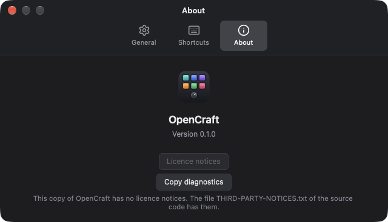

# Faults and corrections

## Messages in the window

When OpenCraft has a problem, the window shows a message at the bottom of
the device picture, directly above the status bar. The message stays until
you click **Close** on it. If the same problem occurs
again, the window shows the message one time only. A message that occurs
when no window is open shows when you open the window. The log file also
gets each message. See [The log file](background.md#the-log-file).

| Message starts with | Cause | Correction |
|---|---|---|
| The name of an action kind and a colon, for example "Open a URL:" | An action has a setting that is missing or not correct. The message gives the field. | Select the control, and correct the field of the action. See [Actions](actions.md). |
| "OpenCraft did not send the keys, because it does not have the Accessibility permission" | An action "Send a hotkey", "Type text", or "Media key" occurred, and OpenCraft does not have the permission | See [Give the Accessibility permission](install.md#give-the-accessibility-permission) |
| "Cannot open the application" | macOS cannot find the application | Use the full name of the application, or click **Choose…** and select it |
| "The shell command ends with code" | The command of "Run a shell command" stopped with an error | Run the command in Terminal to find the error. Give the full path of each program. |
| "OpenCraft did not change the profile, because no profile has the name" | The action "Select a profile" names a profile that does not exist | Correct the name in the action, or rename the profile |
| "The profile has no page" | The action "Change the page" names a page number that does not exist | Correct the page number |
| "OpenCraft did not do the change: the window showed a different profile" | You clicked a page row of a profile that is not active now. The window showed an old picture, for example after the screen was locked. | Look at the window again. It shows the active profile. Then do the change again. |
| "Cannot do the Mac system function: macOS does not allow sleep now" | A setting turns off all sleep, for example `pmset disablesleep 1` from an application that keeps the Mac awake | Turn off that setting in the application, or run `sudo pmset disablesleep 0` in Terminal. Then the action can put the Mac to sleep. |
| "A toggle or a sequence contains an action that this version of OpenCraft does not have" | A newer version of OpenCraft made the action | Select a different action in the toggle or the sequence |
| "OpenCraft cannot open the device" | A different application, for example VSD Craft, holds the device | See [The vendor software runs](#the-vendor-software-runs) |
| "OpenCraft found the device, but cannot open it", "OpenCraft has a problem with the device" | OpenCraft cannot operate the device | See [The device is not found](#the-device-is-not-found) |
| "OpenCraft could not use the profile file" | The profile file has an error, or a newer version of OpenCraft wrote it | OpenCraft keeps the file with a different name, and starts with an empty profile. The message gives the name of the file. |
| "OpenCraft could not use the image" | The file is not a PNG or JPEG image | Select a different file |
| "OpenCraft could not import the profile" | The file is not a profile file of OpenCraft, it is too large, it has an error, a newer version of OpenCraft made it, or its profile is for a different device model. The message gives the cause. | Export the profile again, or use a newer version of OpenCraft. See [Export and import a profile](controls.md#export-and-import-a-profile). |
| "OpenCraft could not export the profile" | OpenCraft cannot write the file, for example in a folder that you cannot change | Select a different folder |

## The device is not found

The connection in the toolbar shows "Not connected", and the device does not
change.

1. Quit VSD Craft. See [The vendor software runs](#the-vendor-software-runs).
2. Connect the cable to the port on the device that shows "PC". Do not
   use a different port on the device.
3. Connect the other end of the cable directly to a USB port of the
   computer. Do not use a USB hub or a dock. Do not use a port on a monitor.
   On a desktop computer, use a port on the back.
4. If the device is still not found, disconnect the cable. Wait 5 seconds.
   Connect it again. Use a different USB cable if you have one. Some cables
   carry only power and no data.
5. Wait some seconds. OpenCraft looks for the device each second. You do not
   have to start OpenCraft again.

If the window shows a message about the device, read the full message. It
gives the correction. The log file gives the technical cause. See
[The log file](background.md#the-log-file).

## The vendor software runs

Two applications must not operate one device at the same time. If VSD Craft
runs, these problems can occur:

- OpenCraft cannot open the device. The window shows the message "OpenCraft
  cannot open the device".
- The device shows the images of one application, and then of the other.
- One gesture does an action in the two applications.

To correct the problem:

1. Quit VSD Craft. Closing its window is not sufficient. See
   [Quit the vendor software first](install.md#quit-the-vendor-software-first).
2. Disconnect the device, and connect it again.

## "OpenCraft is already running."

OpenCraft already runs, and a second start from the Terminal stopped. This is
correct. Only one OpenCraft can operate the device. The OpenCraft that runs
opens its window.

If the message continues with "To open its window, click the OpenCraft item
in the menu bar":

1. Click the OpenCraft item in the menu bar.
2. Click **Open OpenCraft**.

If you do not see the menu bar item, the menu bar can be too full. Quit a
different menu bar application, or make the window of the application in
front smaller. To stop the OpenCraft that runs, open Activity Monitor, select
OpenCraft, and quit it.

## An action does nothing

1. Look above the status bar for a message. See
   [Messages in the window](#messages-in-the-window). To make the action
   run with no push on the device, click **Test the action** in the open
   card. See [Test an action](actions.md#test-an-action).
2. Make sure that the connection in the toolbar shows "Live on the device".
3. Look at the left side of the status bar, and do the gesture again. If the
   status bar does not show the gesture with "now", OpenCraft does not get
   the gesture. See [The device is not found](#the-device-is-not-found).
4. Make sure that the action is on the correct gesture, for example
   **Press** and not **Release**. The card of a gesture with an action
   shows the name of the action.
5. Make sure that the device shows the page that has the action. The page
   header at the top of the device picture shows the name of the active
   page. In the sidebar, the active page is the selected row.
6. For "Send a hotkey", "Type text", and "Media key": make sure that
   OpenCraft has the Accessibility permission. If it does not have the
   permission, these actions do nothing, and the window shows a message
   above the status bar. See
   [Give the Accessibility permission](install.md#give-the-accessibility-permission).
7. If the button of the card shows **Not available**, this version of
   OpenCraft does not have the action kind. A newer version of OpenCraft
   made the action. OpenCraft keeps the action in the profile. Select a
   different action kind, or use a newer version of OpenCraft. The card
   shows the identifier of the action kind in the profile file. See
   [An action that is not available](actions.md#an-action-that-is-not-available).

If a hotkey operates in some applications only, the application in front can
ignore that hotkey. Try the hotkey on the keyboard of the computer.

If an action that needs the Accessibility permission does nothing after a
start at login, quit OpenCraft and open it from the Applications folder. Then
do the action again.

## The device goes dark

| What you see | Cause | Correction |
|---|---|---|
| The displays and the knob lights are off | OpenCraft quit. This is correct after a quit. | Start OpenCraft |
| The device shows its own logo | No application operates the device. OpenCraft did not quit normally, or it does not run. | Start OpenCraft. If it runs, quit it with the menu bar item, and start it again. |
| The displays are dark after the computer slept | OpenCraft draws all displays again after a wake | Wait some seconds. If the displays stay dark, disconnect the device and connect it again. |
| The displays are very dim | The display brightness is low | Increase the display brightness. See [Device settings](controls.md#device-settings). |

## The window does not open

- If OpenCraft started at login, it opens no window. Click the menu bar item,
  and click **Open OpenCraft**.
- If you turned off **Show the window at start** in the Settings window,
  OpenCraft opens no window when it starts. Click the menu bar item, and
  click **Open OpenCraft**.
- If OpenCraft already runs and you closed its window, a new start from the
  Applications folder or a click on the Dock icon opens the window. If no
  window opens, click the menu bar item, and click **Open OpenCraft**.

## Report a fault

1. Open **Settings > About** and click **Copy diagnostics**.
2. Open the [issue page](https://github.com/shantanugoel/OpenCraft/issues).
   Tell what you did, what you expected and what occurred.
3. Paste the diagnostics into the report. Read the text before you send it.

The diagnostics give the application version, device model and firmware,
macOS version, architecture and the end of the log. They remove free-form
log details, serial numbers, user names and host names. A home path is
replaced with `~` in a privacy marker. The log file on disk does not change.
No report is sent until you send the issue yourself.

If more fault details are necessary, read the log before you attach it.
Remove all personal data first. See [The log file](background.md#the-log-file).

## The supported device

| Device | State |
|---|---|
| VSD StreamDock N4 Pro (VSDinside) | Supported. Tested on the device. |
| Mirabox StreamDock N4 Pro, Mirabox StreamDock N4 Pro E | OpenCraft knows these models, because they have the same layout. Nobody tested them. |

The Mac and the macOS version that OpenCraft needs are in
[What you need](install.md#what-you-need).

## Limits

These limits apply to this version of OpenCraft:

- OpenCraft operates one device at a time.
- The touch bar shows four bar panels. To show one picture across the full
  touch bar, use a [page background](controls.md#the-background-of-a-page),
  and give the bar panels no fill.
- A swipe has no position. Thus a swipe does the same action on all of the
  touch bar.
- Key faces, bar panels, and page backgrounds show still images only.
  Animation and video are not possible.
- OpenCraft does not change the start logo of the device.
- OpenCraft has no plug-ins. It cannot use plug-ins of VSD Craft or of the
  Stream Deck software.
- OpenCraft cannot import the profiles of VSD Craft.
- The state of a toggle is not kept when OpenCraft quits.
- The device settings are for the device model. Two devices of one model use
  the same device settings.
