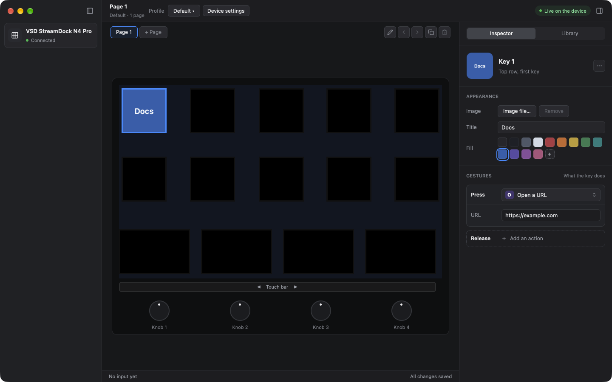
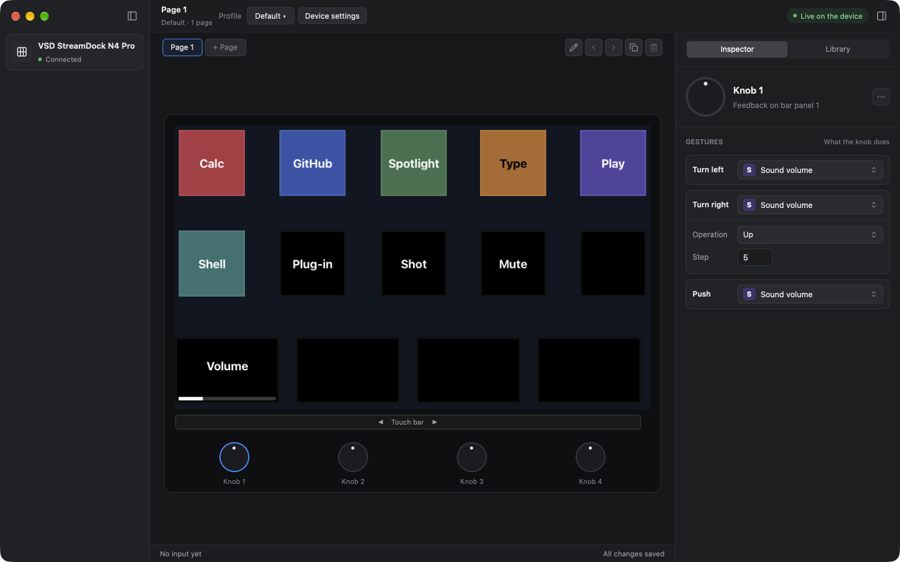

# Configure a key

This procedure makes key 1 open a web page. It uses the title, the fill
colour, the image, and the action of one key. Do the steps in their order.

Before you start, do the steps in [Install and first start](install.md).

## 1. Select the key

1. In the device picture, click the key face at the top left. This is key 1.

The key face gets a blue frame. The **Inspector** tab of the right panel
shows the key. If the right panel shows **Library**, click **Inspector** at
the top of the right panel. The inspector has these parts, from the top:

| Part | What it shows |
|---|---|
| Header | The image of the key face, the name "Key 1", and the position "Top row, first key" |
| **Appearance** | The rows **Image**, **Title**, and **Fill** |
| **Gestures** | One card for each gesture of the key: **Press** and **Release** |

If the inspector is not tall enough, it shows a scrollbar at the right.
Scroll the inspector to see the other parts.

## 2. Set the title and the fill

1. Click the field **Title**. Type a short text, for example `Docs`.
2. In the row **Fill**, click a colour.

The key face in the window and key 1 on the device show the title on the
colour. OpenCraft selects black or white for the text, so that you can read
it on the colour. The selected colour has a blue frame.

- To remove the fill colour, click the first sample of the row. Its name is
  "No fill".
- To use a different colour, click **+** at the end of the row. Type the
  colour as `#RRGGBB`, for example `#1A6FD8`, and push Return. To close the
  field with no change, push Esc.
- To remove the title, delete the text in the field.

## 3. Set an image (optional)

1. In the row **Image**, click **Image file…**.
2. In the file dialog, select a PNG or JPEG file, and click
   **Select an image**.

The key face shows the image above the title. A transparent part of the
image shows the fill colour of the key face.

- OpenCraft makes a copy of the image in the profile. You can move or delete
  the original file after this step.
- A large image becomes smaller. A square image is best for a key face.
- To remove the image, click **Remove**.

## 4. Set an action

Below **Gestures**, the inspector shows one card for each gesture of the
key: **Press** and **Release**. An action on **Press** occurs when you push
the key down. An action on **Release** occurs when you let the key come back
up. Most actions are on **Press**. A card with no action shows
"Add an action".

1. On the card **Press**, click **Add an action**. The menu of the action
   kinds opens.
2. Click **Open a URL**. The card opens and shows the settings of the
   action.
3. Click the field **URL**. Type `https://example.com`.

The action "Open a URL" does not need a permission of macOS.

- A card with an action shows the name of the action on a button. One card
  is open at a time. Click the gesture name of a card to open or close the
  card. The inspector keeps the open card of each control while OpenCraft
  runs.
- To change the action kind, click the button with the action name, and
  click a different kind. The settings of the new kind start at their
  default values.
- To remove the action, click the button with the action name, and click
  **Remove the action**.
- To close a menu with no change, push Esc, or click out of the menu.

The picture shows a different action: the sound volume on knob 1. Each
action kind has its own settings. They are in [Actions](actions.md).

## 5. Push the key

1. Push key 1 on the device.

The browser opens the page. The status bar at the bottom of the device
picture shows "Key 1 · Press · now", and then "Key 1 · Release · now".

## How OpenCraft saves your changes

OpenCraft saves each change immediately. The window has no "Save" button.
You can close the window at any time. You can also make changes when no
device is connected.

## If the key does nothing

- Look above the status bar. If a message shows, read it. See
  [Messages in the window](faults.md#messages-in-the-window).
- Make sure that the connection in the toolbar shows "Live on the device".
- Make sure that the action is on the card **Press**, not on the card
  **Release**.
- For "Send a hotkey", "Type text", and "Media key", OpenCraft needs the
  Accessibility permission. See
  [Give the Accessibility permission](install.md#give-the-accessibility-permission).

More corrections are in [Faults and corrections](faults.md).

## Next steps

- Configure the other keys in the same way.
- Use a knob, a bar panel, or the touch bar. See
  [Knobs, touch bar, pages, and profiles](controls.md).
- Make more pages for more actions. See [Pages](controls.md#pages).
