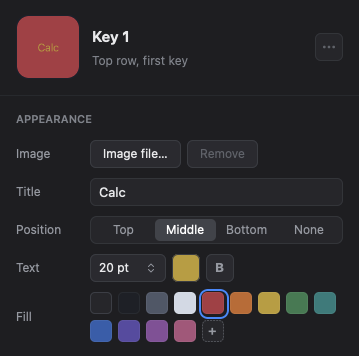
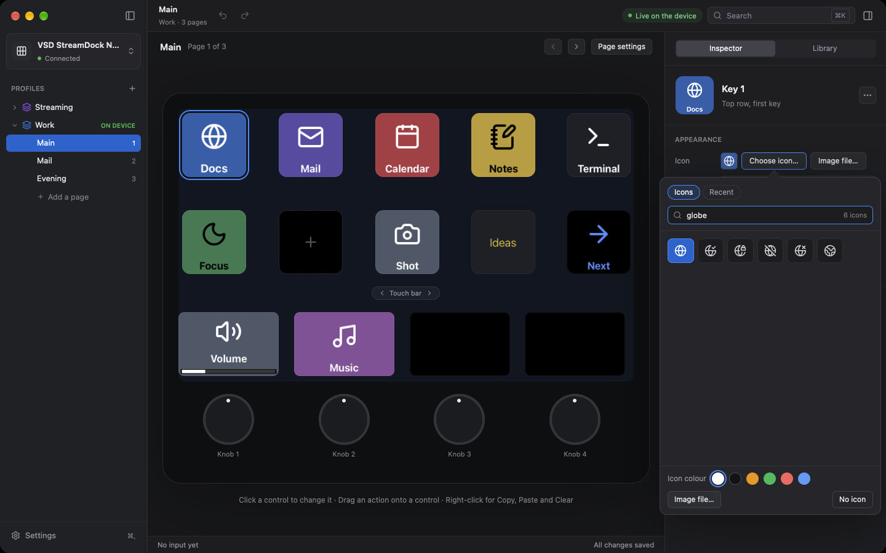
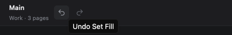
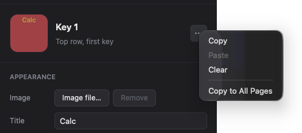
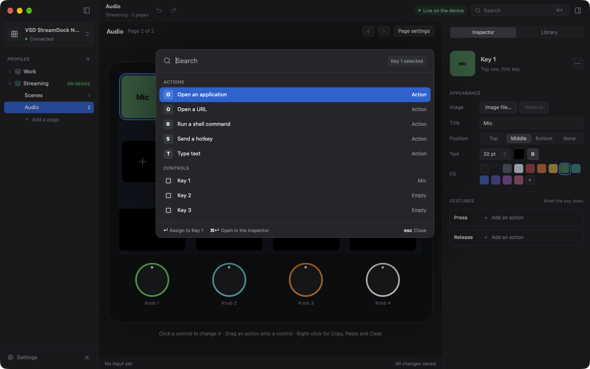
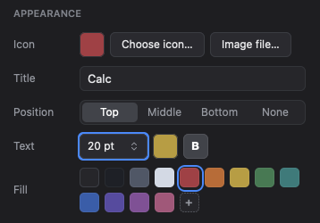

# Configure a key

This procedure makes key 1 open a web page. It uses the title, the fill
colour, the icon, and the action of one key. Do the steps in their order.

Before you start, do the steps in [Install and first start](install.md).
If you started with a starter profile that is not **Empty**, key 1 has a
title and an action already. This procedure replaces them. To keep them, do
the procedure on a different key, or add a page first. See
[Pages](controls.md#pages).

## 1. Select the key

1. In the device picture, click the key face at the top left. This is key 1.
   At the start, it is selected already.

The key face has a blue outline. The **Inspector** tab of the right panel
shows the key. If the right panel shows **Library**, click **Inspector** at
the top of the right panel. The inspector has these parts, from the top:

| Part | What it shows |
|---|---|
| Header | The image of the key face, the name "Key 1", and the position "Top row, first key" |
| **Appearance** | The rows **Icon**, **Title**, **Position**, **Text**, and **Fill** |
| **Gestures** | One card for each gesture of the key: **Press** and **Release** |

If the inspector is not tall enough, it shows a scrollbar at the right.
Scroll the inspector to see the other parts.

## 2. Set the title and the fill

1. Click the field **Title**. Type a short text, for example `Docs`.
2. In the row **Fill**, click a colour.

The key face in the window and key 1 on the device show the title on the
colour. OpenCraft selects black or white for the text, so that you can read
it on the colour. The selected colour has a blue frame.

- To remove the fill, click the first sample of the row. Its name is
  "No fill".
- To use a different colour, click **+** at the end of the row. Type the
  colour as `#RRGGBB`, for example `#1A6FD8`, and push Return. To close the
  field with no change, push Esc.
- To remove the title, delete the text in the field.

### Change the look of the title (optional)

The rows **Position** and **Text** change how the title shows. They are
below the field **Title**.

| Row | Control | What it does |
|---|---|---|
| **Position** | **Top**, **Middle**, **Bottom**, **None** | Puts the title at the top, at the centre, or at the bottom of the key face. **None** hides the title. The text stays in the field **Title**. |
| **Text** | The size button, for example "20 pt" | Click it, and click a size from 10 pt to 32 pt. |
| **Text** | The colour button | Click it, and click a colour. Or type the colour as `#RRGGBB`, and push Return. **A** (Automatic) selects black or white for the fill. To close the colour list with no change, push Esc. |
| **Text** | **B** | Bold. Click it to change the title to bold or to normal. **B** is light when the title is bold. |

- At the start, a title is bold, 20 pt, and in the automatic colour. With
  no icon and no image, it is at the centre. With an icon or an image, it is
  at the bottom.
- If a long title does not fit at its size, OpenCraft makes the text
  smaller.
- With an icon or an image, a title at the top or at the bottom has its own
  band, and the icon or the image is smaller. A title at the middle is on
  the icon or the image.
- A bar panel has the same rows.

## 3. Set an icon (optional)

OpenCraft has a set of 1,818 line icons. You do not need an image file.

1. In the row **Icon**, click **Choose icon…**. The icon picker opens below
   the button.
2. Type a word in the field **Search icons**, for example `globe`. The grid
   shows the icons that agree with the word. The field has the cursor when
   the icon picker opens.
3. Click an icon.

The key face in the window and key 1 on the device show the icon above the
title. The icon of the key has a blue cell in the grid. The icon picker stays
open, so that you can try more icons.

| To do this | Do this in the icon picker |
|---|---|
| Find an icon | Type a word in the search field. A word can be a part of the name, for example `arr` for the arrows, or a word for the use, for example `mute`. With no word, the grid shows all icons in groups, for example **MULTIMEDIA**. The number at the right of the field is the number of icons in the grid. |
| Use an icon again | Click **Recent**. It shows the last 21 icons that you selected, the newest first. Click **Icons** to see all icons again. |
| Change the colour of the icon | In the row **Icon colour**, click a colour. The icon changes immediately. If the key has no icon yet, the next icon that you click gets the colour. |
| Use an image file in place of the icon | Click **Image file…**. See [Set an image](#set-an-image). |
| Remove the icon or the image | Click **No icon**. |
| Close the icon picker | Push Esc, or click outside the icon picker. |

- At the start, an icon has the automatic colour: black or white, the
  colour that shows best on the fill.
- The tile at the start of the row **Icon** shows the icon on the fill
  colour of the key.
- A key has an icon or an image, not both. A new icon removes the image, and
  a new image removes the icon.
- Each new icon and each new colour is one change. You can undo it. See
  [Undo a change](#undo-a-change).
- The icons are from Lucide. The licence notices of OpenCraft include the
  licence of the icons.

### Set an image

You can use an image file in place of an icon.

1. In the row **Icon**, click **Image file…**. Or click **Image file…** in
   the icon picker.
2. In the file dialog, select a PNG or JPEG file, and click **Choose**.

The key face shows the image above the title. A transparent part of the
image shows the fill of the key face.

- OpenCraft makes a copy of the image in the profile. You can move or delete
  the original file after this step.
- A large image becomes smaller. A square image is best for a key face.
- To remove the image, click **Choose icon…**, and click **No icon**.

## 4. Set an action

Below **Gestures**, the inspector shows one card for each gesture of the
key: **Press** and **Release**. An action on **Press** occurs when you push
the key down. An action on **Release** occurs when you let the key come back
up. Most actions are on **Press**. A card with no action shows
"Add an action".

1. On the card **Press**, click **Add an action**. The menu of the action
   kinds opens.
2. Click **Open a URL**. The card opens and shows the settings of the
   action.
3. Click the field **URL**. Type `https://example.com`.

The action "Open a URL" does not need a permission of macOS.

- A card with an action shows the name of the action on a button. One card
  is open at a time. Click the gesture name of a card to open or close the
  card. The inspector keeps the open card of each control while OpenCraft
  runs.
- To change the action kind, click the button with the action name, and
  click a different kind. The settings of the new kind start at their
  default values.
- The menu of the action kinds shows the kinds in groups, for example
  **System** and **Media**. You can also set an action from the tab
  **Library**: see [The library](actions.md#the-library).
- To remove the action, click the button with the action name, and click
  **Remove the action**.
- A menu of OpenCraft works with the keyboard, as a menu of macOS does. The
  first item is highlighted when the menu opens, and the highlight follows
  the pointer. Push Down or Up to move the highlight. Push Home or End to
  go to the first or the last item. Push a letter to go to the first item
  that starts with it. Push Return to select the highlighted item.
- To close a menu with no change, push Esc, or click out of the menu.

Each action kind has its own settings. They are in [Actions](actions.md).

## 5. Push the key

1. Push key 1 on the device.

The browser opens the page. The status bar at the bottom of the device
picture shows "Key 1 · Press · now", and then "Key 1 · Release · now".

## How OpenCraft saves your changes

OpenCraft saves each change immediately. The window has no "Save" button.
You can close the window at any time. You can also make changes when no
device is connected.

## Undo a change

You can undo each change to the pages of the profile, and then do it again.

| To do this | Do one of these |
|---|---|
| Undo the last change | Click the arrow to the left in the toolbar, after the page name. Or select **Edit > Undo**. Or push Command-Z. |
| Do the change again | Click the arrow to the right in the toolbar. Or select **Edit > Redo**. Or push Shift-Command-Z. |

- The menu item and the tooltip of the button show the name of the change,
  for example **Undo Set Title**. If there is no change to undo, the button
  is dim and does nothing.
- An undo shows the page of the change. The device shows the result
  immediately, and OpenCraft saves it.
- All the text that you type in one field is one change: from the first
  letter to the Return key, or to a click in a different part of the window.
- When a text field has the cursor, Command-Z and **Edit > Undo** undo the
  typing in that field only. The toolbar button undoes the last change of
  the profile.
- The undo covers the title and its position, size, colour, and weight, the
  fill, the icon and its colour, the image, the actions, the background of
  a page, the add, rename, move, duplicate, and removal of a page, and
  **Paste**, **Clear**, and **Copy to All Pages**.
- The undo does not cover the profiles and the device settings.
- Each profile keeps its own list of changes until you quit OpenCraft. When
  you select a different profile, or when the profile changes with the front
  application, the list of that profile shows. When you go back, the list of
  the first profile comes back. OpenCraft keeps the lists of the last 8
  profiles that you left. When you remove a profile, its list goes away.

## Copy a key to a different key

You can copy all of a key to a different key: the title, the look of the
title, the fill, the icon or the image, and the actions of all its
gestures. You can do
the same with a bar panel and a knob.

| To do this | Do one of these |
|---|---|
| Copy the selected control | Select **Edit > Copy**. Or push Command-C. Or right-click the control, and select **Copy**. Or click **⋯** at the top of the inspector, and select **Copy**. |
| Put the copy on the selected control | Select **Edit > Paste**. Or push Command-V. Or right-click the control, and select **Paste**. Or use the **⋯** menu. |
| Remove all of the selected control | Select **Edit > Clear**. Or push Delete. Or right-click the control, and select **Clear**. Or use the **⋯** menu. |
| Put the selected control on each page | Click **⋯** at the top of the inspector, and select **Copy to All Pages**. The same control on each page of the profile gets the title, the fill, the icon or the image, and the actions. |

- **Paste** replaces all of the control. The control that you paste on
  keeps nothing of its old title, fill, icon, image, and actions.
- You can paste a key only on a key, a bar panel only on a bar panel, and a
  knob only on a knob. If the copy is of a different kind, **Paste** is dim,
  and the status bar tells you why when you push Command-V.
- A knob takes its bar panel with it: the bar panel that shows the feedback
  of the knob, with its title, fill, icon or image, and its **Tap** action.
- You can paste on a different page, and in a different profile. The copy
  stays until you copy a different control or quit OpenCraft.
- When a text field has the cursor, Command-C, Command-V, Delete, and the
  menu items **Edit > Copy**, **Paste**, and **Clear** are for the text in
  that field only.
- Each **Paste**, **Clear**, and **Copy to All Pages** is one change. You can
  undo it. See [Undo a change](#undo-a-change).

## The command palette (Command-K)

The command palette finds action kinds, controls, pages, profiles, and
commands. You can do all of this procedure with the keyboard.

1. Push Command-K. Or click the search field at the right of the toolbar.
   Or select **Edit > Search…**. The command palette opens in the centre of
   the window. Command-K also operates when a text field has the cursor.
2. Type a part of a name, for example `url`, `key 3`, `audio`, or
   `sidebar`. The list shows the results in five groups. Each group shows
   five results at the most.
3. Push the Down arrow or the Up arrow to select a result. The list scrolls
   with the selection.
4. Push Return. The bottom line of the command palette tells what Return
   does.

| Group | What it finds | What Return does |
|---|---|---|
| Actions | The action kinds of the library, by name | Sets the action on the selected control, as a click in the [library](actions.md#the-library) does |
| Controls | The controls of the page on the device, by name (for example "Key 3") and by title | Selects the control |
| Pages | The pages of all profiles. The text at the right shows the profile and the page number. | Shows the page on the device. A page of a different profile also makes that profile active. |
| Profiles | The profiles. "On device" shows at the right of the active profile. | Makes the profile active |
| Commands | The commands of the window, for example **Add a page**, **Page settings**, **Device settings**, **Add a profile**, **Settings…**, **Hide Sidebar**, and **Undo**. The key command shows at the right. | Does the command |

- The text at the top right, for example "Key 8 selected", shows the
  control that gets an action.
- Command-Return does the same as Return, and then shows the result in the
  tab **Inspector**: the control with the new action, the selected control,
  or the selected page.
- A command shows only when you can do it now. For example, **Undo** shows
  only when there is a change to undo.
- Push Escape, or click outside the command palette, to close it with no
  change.
- If nothing agrees with your text, the command palette shows "No result
  for" and your text.

## Operate the window with the keyboard

You can operate each button, popup button, switch, slider, colour sample, row,
and card of the window with the keyboard.

| To do this | Push |
|---|---|
| Go to the next control | Tab |
| Go to the previous control | Shift-Tab |
| Click the control with the focus | Space or Return |
| Move a slider, for example the brightness | Left arrow or Right arrow |
| Select an item in an open menu | Up arrow or Down arrow, then Space or Return |
| Select a starter profile in the first start window | The arrow keys |

- The control with the focus has a blue ring. The ring shows only when you
  use the keyboard. A click does not move the focus to a control, and it
  removes the ring.
- Tab goes through the sidebar, the toolbar, the page header, the tabs of
  the right panel, and the inspector, in this order. In a sheet, in the
  command palette, and in a popover, Tab stays in that part. When you open
  one of them with the keyboard and then close it, the focus goes back to
  the control that opened it.
- In a sheet, Return clicks the blue button (for example **Done**), also
  when a different button has the focus. Space clicks the button with the
  focus. Escape closes the sheet.
- The controls of the device picture and the actions of the library are not
  in the Tab order. Use Command-K: type `key 3` to select a key, or the name
  of an action to set it. See
  [The command palette](#the-command-palette-command-k).
- The key commands of the window, for example Command-Z and Command-K,
  operate also when a control has the focus.
- When a button has the focus, Delete clears the selected control, as
  **Edit > Clear** does. Command-Z restores it. When a text field has the
  cursor, Delete removes a character of the text.

## If the key does nothing

Look above the status bar. If a message shows, read it. Then do the steps
in [An action does nothing](faults.md#an-action-does-nothing).

## Next steps

- Configure the other keys in the same way.
- Use a knob, a bar panel, or the touch bar. See
  [Knobs, touch bar, pages, and profiles](controls.md).
- Make more pages for more actions. See [Pages](controls.md#pages).
