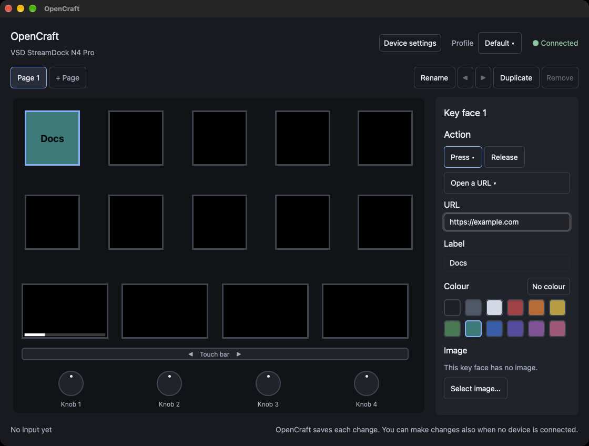

# Install and first start

## What you need

- A Mac with Apple silicon.
- macOS 12 or later. The project tested OpenCraft on macOS 27 only.
- A VSD StreamDock N4 Pro. See [The supported device](faults.md#the-supported-device).
- A USB cable from the device to the Mac.

`OpenCraft.app` is signed and notarized.

## Install OpenCraft

Use one of the two procedures.

### Install with Homebrew

1. Open the application Terminal.
2. Type this command and push Return:

   ```sh
   brew install --cask shantanugoel/opencraft/opencraft
   ```

Homebrew puts `OpenCraft.app` in the Applications folder.

### Install by hand

1. Open the
   [releases page](https://github.com/shantanugoel/OpenCraft/releases) of
   OpenCraft.
2. Download the file `OpenCraft-<version>-arm64.dmg` of the newest version.
3. Open the downloaded file.
4. Move OpenCraft to the Applications folder.

Do not start OpenCraft from the downloaded file. Start it from the
Applications folder.

## Quit the vendor software first

Two applications must not operate one device at the same time. If VSD Craft
is installed, quit it before you start OpenCraft.

1. Find the VSD Craft icon in the menu bar or in the Dock.
2. Quit VSD Craft.

VSD Craft continues to run when you close its window. Thus it is not
sufficient to close the window. If VSD Craft starts at login, turn that option off in
VSD Craft, or in System Settings > General > Login Items.

## Start OpenCraft for the first time

1. Connect the device to the Mac.
2. Open OpenCraft from the Applications folder.

OpenCraft opens its window. If you have no profile, OpenCraft makes the
profile "Default" with one empty page. The key faces and the bar panels are
black.



The window has these parts:

| Part | Position | What it shows |
|---|---|---|
| Device name | Top left | The model of the device, for example "VSD StreamDock N4 Pro" |
| **Device settings** | Top right | Opens the device settings. See [Device settings](controls.md#device-settings). |
| **Profile** | Top right | The active profile, and a menu for the profiles |
| Connection | Top right | "● Connected", or "○ Not connected" |
| Page row | Below the top | One button for each page, **+ Page**, and the tools for the active page |
| Device picture | Middle | The 10 key faces, the 4 bar panels, the touch bar, and the 4 knobs. Each key face and bar panel shows the same image as the device. |
| Editor | Right | The settings of the control that you selected |
| Input line | Bottom left | The last gesture on the device, for example "key 3: press" |

When you push a key, turn a knob, or touch the touch bar, the device picture
shows it.

### Keys and bar panels: the numbers

| Control | Numbers |
|---|---|
| Keys | 1 to 5 in the top row, from left to right. 6 to 10 in the second row, from left to right. |
| Bar panels | 1 to 4, from left to right |
| Knobs | 1 to 4, from left to right. Knob N is below bar panel N. |

### When no device is connected

The window opens also with no device. The connection shows
"○ Not connected". Put the pointer on it to see what to do. You can change
all settings. OpenCraft
saves them, and the device shows them when you connect it. OpenCraft looks
for the device each second. You do not have to start OpenCraft again.

## Give the Accessibility permission

Three action kinds need the Accessibility permission of macOS: "Send a
hotkey", "Type text", and "Media key". These actions send keys to other
applications. The other action kinds do not need a permission. OpenCraft
also does not need the Input Monitoring permission.

If OpenCraft does not have the permission, the editor shows this text below
each action of these kinds: "OpenCraft needs the Accessibility permission to
send keys." Then the action does nothing. When you do the action on the
device, the window shows the message "OpenCraft did not send the keys,
because it does not have the Accessibility permission." at the bottom.

To give the permission:

1. Select a control that has one of these actions. See
   [Configure a key](first-key.md).
2. Below the action, click **Give the permission**. macOS shows a message
   about the Accessibility access.
3. Click **Open System Settings** in the message.
4. In System Settings > Privacy & Security > Accessibility, turn on
   OpenCraft.

OpenCraft checks the permission each second for 10 minutes after you click
the button. When it has the permission, the text in the editor goes away. It
also checks the permission each time that you do one of these actions.

You can also give the permission before the first use: in System Settings >
Privacy & Security > Accessibility, click **+**, and select OpenCraft in the
Applications folder.

## Remove OpenCraft

1. Click the OpenCraft item in the menu bar. If **Start at login** has a
   check mark, click it to turn it off. This removes the file that starts
   OpenCraft at login.
2. Click the menu bar item again, and click **Quit OpenCraft**.
3. Remove the application. Use the procedure that agrees with the
   installation:

   - Homebrew: type `brew uninstall --cask opencraft`. This removes only the
     application. To also move your profiles, your settings, and the other
     files of OpenCraft to the Trash, type
     `brew uninstall --zap --cask opencraft`. Make a copy of the folder
     `~/Library/Application Support/OpenCraft` first if you want to keep
     your profiles.
   - By hand: move OpenCraft from the Applications folder to the Trash.

4. Optional: if you did not use `--zap`, remove the folder
   `~/Library/Application Support/OpenCraft` to remove your profiles and
   settings. Make a copy first if you want to keep your profiles. See
   [The files of OpenCraft](background.md#the-files-of-opencraft).
5. Optional: in System Settings > Privacy & Security > Accessibility, select
   OpenCraft and click **−**.

When OpenCraft quits, the displays of the device become dark. That is
correct.
