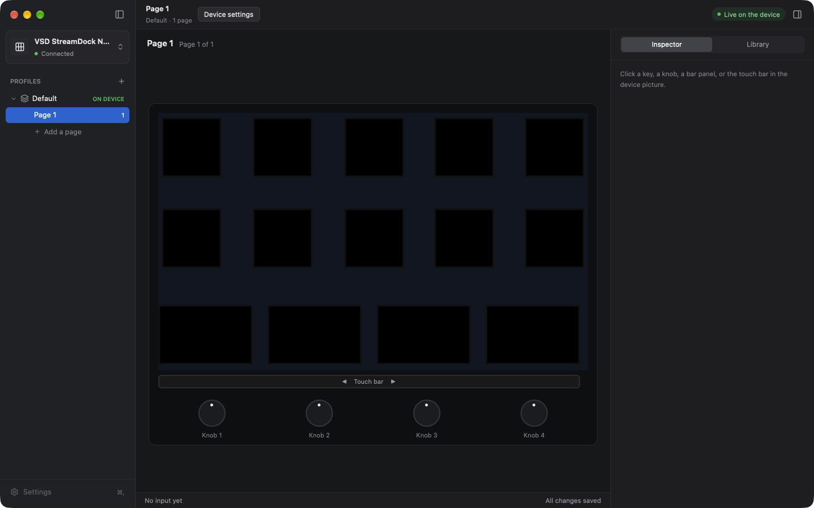

# Install and first start

## What you need

- A Mac with Apple silicon.
- macOS 12 or later. The project tested OpenCraft on macOS 27 only.
- A VSD StreamDock N4 Pro. See [The supported device](faults.md#the-supported-device).
- A USB cable from the device to the Mac.

`OpenCraft.app` is signed and notarized.

## Install OpenCraft

Use one of the two procedures.

### Install with Homebrew

1. Open the application Terminal.
2. Type this command and push Return:

   ```sh
   brew install --cask shantanugoel/opencraft/opencraft
   ```

Homebrew puts `OpenCraft.app` in the Applications folder.

### Install by hand

1. Open the
   [releases page](https://github.com/shantanugoel/OpenCraft/releases) of
   OpenCraft.
2. Download the file `OpenCraft-<version>-arm64.dmg` of the newest version.
3. Open the downloaded disk image. A window opens. It shows OpenCraft and a
   shortcut with the name Applications.
4. Drag OpenCraft onto the shortcut Applications. This copies OpenCraft to
   the Applications folder.
5. Eject the disk image: in the sidebar of the Finder, click the eject
   button next to "OpenCraft <version>".

Do not start OpenCraft from the disk image. Start it from the Applications
folder. After the copy, you can delete the downloaded disk image.

## Quit the vendor software first

Two applications must not operate one device at the same time. If VSD Craft
is installed, quit it before you start OpenCraft.

1. Find the VSD Craft icon in the menu bar or in the Dock.
2. Quit VSD Craft.

VSD Craft continues to run when you close its window. Thus it is not
sufficient to close the window. If VSD Craft starts at login, turn that option off in
VSD Craft, or in System Settings > General > Login Items.

## Start OpenCraft for the first time

1. Connect the device to the Mac.
2. Open OpenCraft from the Applications folder.

OpenCraft opens its window. If you have no profile, OpenCraft makes the
profile "Default" with one empty page. The key faces and the bar panels are
black. No control is selected. Thus the inspector at the right shows only the
text "Select a control, the page, or the device." The knob lights on the device show colours that change slowly. This
is the default of the [device settings](controls.md#device-settings).



The window has three panes: the sidebar at the left, the device picture in
the middle, and the right panel. The parts:

| Part | Position | What it shows |
|---|---|---|
| Sidebar | Left | At the top, the device: its model, for example "VSD StreamDock N4 Pro", and "Connected" or "Not connected". Below it, the [profiles and the pages](controls.md#pages). At the bottom, **Settings**, which is not available in this version. |
| Toolbar | Top, above the device picture and the right panel | The name of the active page, the active profile and its number of pages, **Device settings**, and the connection |
| Connection | Toolbar, right | "Live on the device", or "Not connected" |
| Page title | Top of the device picture | The name of the active page, and its position, for example "Page 1 of 3" |
| Device picture | Middle | The 10 key faces, the 4 bar panels, the touch bar, and the 4 knobs. Each key face and bar panel shows the same image as the device. |
| Right panel | Right | Two tabs. **Inspector** shows the settings of the control that you selected. **Library** is empty in this version. |
| Status bar | Bottom of the device picture | At the left, the last gesture on the device, for example "Key 3 · Press · now". At the right, "All changes saved". |

When you push a key, turn a knob, or touch the touch bar, the device picture
shows it. The status bar shows "now" for 10 seconds after a gesture, and then
the time of the gesture. If you do the same gesture again in less than one
second, it shows the number, for example "Knob 1 · Turn right × 3 · now".

### Show and hide the side panes

You can hide the sidebar and the right panel. The device picture then gets
more space.

| To do this | Do one of these |
|---|---|
| Hide or show the sidebar | Click the button at the top right of the sidebar, or the first button of the toolbar when the sidebar is hidden. Or select **View > Hide Sidebar** (**Show Sidebar**). Or push Control-Command-S. |
| Hide or show the right panel | Click the button at the right end of the toolbar. Or select **View > Hide Inspector** (**Show Inspector**). Or push Option-Command-I. |
| Make a side pane wider or narrower | Drag the line between the pane and the device picture |

OpenCraft keeps the panes, their widths, and the tab of the right panel for
the next start. The sidebar can be 200 to 320 points wide, and the right
panel 320 to 480 points.

To move the window, drag an empty part of the toolbar or of the top of the
sidebar. A double-click there does the double-click action of the title bar
that you set in System Settings.

### Keys and bar panels: the numbers

| Control | Numbers |
|---|---|
| Keys | 1 to 5 in the top row, from left to right. 6 to 10 in the second row, from left to right. |
| Bar panels | 1 to 4, from left to right |
| Knobs | 1 to 4, from left to right. Knob N is below bar panel N. |

### When no device is connected

The window opens also with no device. The connection shows
"Not connected". Put the pointer on it to see what to do. You can change
all settings. OpenCraft
saves them, and the device shows them when you connect it. OpenCraft looks
for the device each second. You do not have to start OpenCraft again.

## Give the Accessibility permission

This step is not necessary to install OpenCraft. Do it only when you first
use "Send a hotkey", "Type text", or "Media key".

Three action kinds need the Accessibility permission of macOS: "Send a
hotkey", "Type text", and "Media key". These actions send keys to other
applications. The other action kinds do not need a permission. OpenCraft
also does not need the Input Monitoring permission.

If OpenCraft does not have the permission, the inspector shows this text below
each action of these kinds: "OpenCraft needs the Accessibility permission to
send keys." Then the action does nothing. When you do the action on the
device, the window shows the message "OpenCraft did not send the keys,
because it does not have the Accessibility permission." above the status
bar.

To give the permission:

1. Select a control that has one of these actions. See
   [Configure a key](first-key.md).
2. Below the action, click **Give the permission**. macOS shows a message
   about the Accessibility access.
3. Click **Open System Settings** in the message.
4. In System Settings > Privacy & Security > Accessibility, turn on
   OpenCraft.

OpenCraft checks the permission each second for 10 minutes after you click
the button. When it has the permission, the text in the inspector goes away. It
also checks the permission each time that you do one of these actions.

You can also give the permission before the first use: in System Settings >
Privacy & Security > Accessibility, click **+**, and select OpenCraft in the
Applications folder.

## Remove OpenCraft

1. Click the OpenCraft item in the menu bar. If **Start at login** has a
   check mark, click it to turn it off. This removes the file that starts
   OpenCraft at login.
2. Click the menu bar item again, and click **Quit OpenCraft**.
3. Remove the application. Use the procedure that agrees with the
   installation:

   - Homebrew: type `brew uninstall --cask opencraft`. This removes only the
     application. To also move your profiles, your settings, and the other
     files of OpenCraft to the Trash, type
     `brew uninstall --zap --cask opencraft`. Make a copy of the folder
     `~/Library/Application Support/OpenCraft` first if you want to keep
     your profiles.
   - By hand: move OpenCraft from the Applications folder to the Trash.

4. Optional: if you did not use `--zap`, remove the folder
   `~/Library/Application Support/OpenCraft` to remove your profiles and
   settings. Make a copy first if you want to keep your profiles. See
   [The files of OpenCraft](background.md#the-files-of-opencraft).
5. Optional: in System Settings > Privacy & Security > Accessibility, select
   OpenCraft and click **−**.

When OpenCraft quits, the displays of the device become dark. That is
correct.
